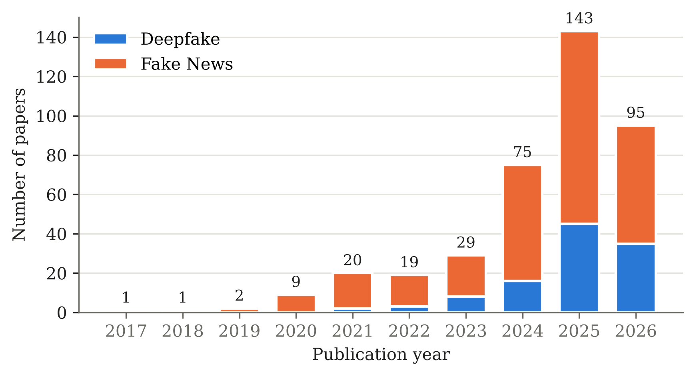
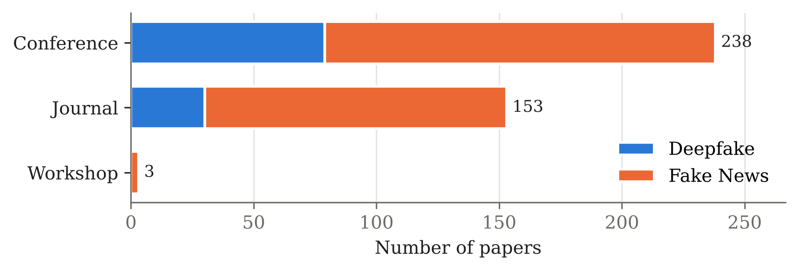
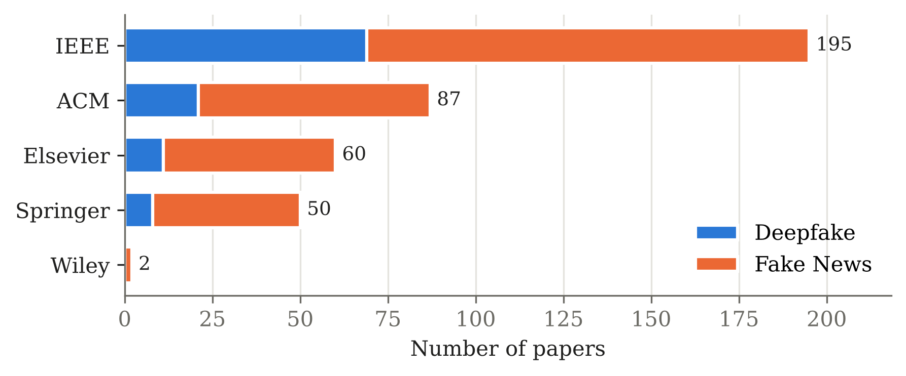
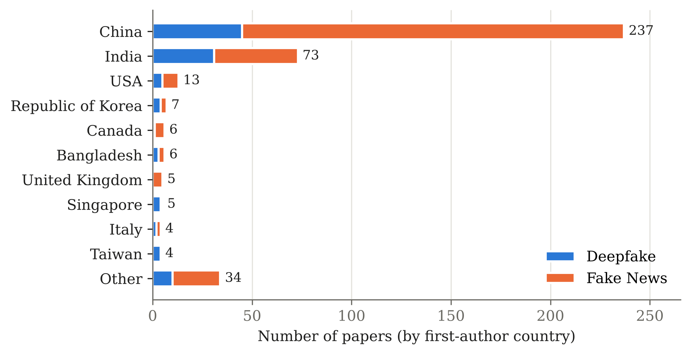
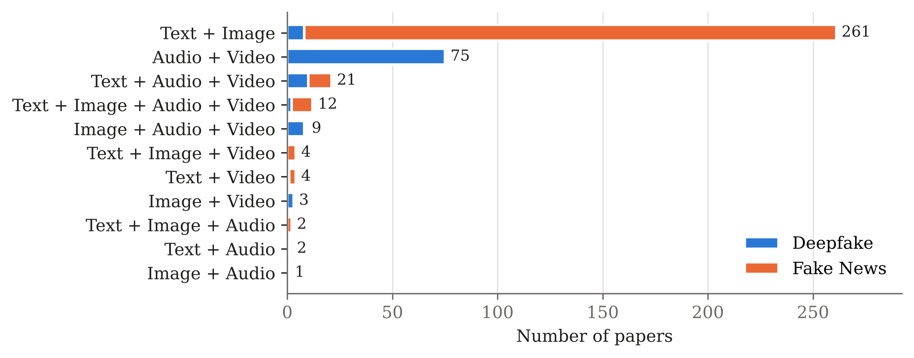

# Multimodal Deepfake & Fake News Detection (SLR)

  

A curated, structured collection of **394 papers** on multimodal deepfake and fake news detection (text, image, audio, video), compiled for a systematic literature review. Every paper has its own page with the extracted methodology, datasets, metrics, features, limitations, robustness findings and BibTeX.

> **Paper:** _Add your SLR title, authors and link here once available._

## Contents
- [Research questions](#research-questions)
- [Statistics](#statistics)
- [Resources](#resources)
- [Paper list](#paper-list)
- [Citation](#citation)
- [Contributing](#contributing)

## Research questions
1. **RQ1** what is deepfake? What kind of deepfake are available in audio, text, image, and video? This question looks at how AI creates or changes content to make deepfakes in different media formats. It studies everything from small changes (like altering a word or facial expression) to completely fake creations in audio, text, images, and videos.
2. **RQ2** What are the Benefits, risks, and challenges in generation and detection? This question examines the advantages, dangers, and technical difficulties of making and finding deepfakes across all media types. It focuses on ethical issues, potential misuse, and the growing difficulty in detection systems.
3. **RQ3** What are the data collection techniques, benchmarks (e.g. evaluation metrics, datasets, and baseline models), and feature extraction in detection? This question studies the essential parts of deepfake detection across all media types, including how data is gathered, benchmark datasets, evaluation methods, and baseline models. It also reviews techniques for extracting features that help identify fake content.
4. **RQ4** What are the state-of-the-art detection techniques in each modality? This question explores the most advanced detection techniques used in audio, text, image, and video modalities. It identifies cutting-edge models, algorithms, and multi-modal strategies that achieve better performance in identifying deepfakes.

## Statistics

| Dimension | Breakdown |
|---|---|
| Category | Fake News (285), Deepfake (109) |
| Venue type | Conference (238), Journal (153), Workshop (3) |
| Publisher | IEEE (195), ACM (87), Elsevier (60), Springer (50), Wiley (2) |
| Year | 2017 (1), 2018 (1), 2019 (2), 2020 (9), 2021 (20), 2022 (19), 2023 (29), 2024 (75), 2025 (143), 2026 (95) |
| Top countries (first author) | China (237), India (73), USA (13), Republic of Korea (7), Canada (6), Bangladesh (6), United Kingdom (5), Singapore (5) |

 

 

Figures are generated by `scripts/plots.py`.

## Resources

| Resource | Description |
|---|---|
| [`data/papers.csv`](data/papers.csv) | All extracted fields for every paper (spreadsheet-friendly) |
| [`data/references.bib`](data/references.bib) | BibTeX for all papers |
| [`docs/datasets.md`](docs/datasets.md) | Benchmark datasets ranked by usage, with papers per dataset |
| [`docs/metrics.md`](docs/metrics.md) | Evaluation metrics ranked by usage |
| [`docs/applications.md`](docs/applications.md) | Positive applications of detection, by category |
| [`papers/`](papers/) | One page per paper with all extracted information |

## Paper list

### Deepfake detection

<b>Audio, Video</b> (75 papers)

| Year | Title | Modalities | Venue | Link |
|---|---|---|---|---|
| 2026 | [Multimodal Deepfake Detection with Quantum State Inspired Analytic Incremental Adaptability Learning](papers/ye2026multimodal.md) | Audio, Video | Conference · ACM | [Scholar](https://scholar.google.com/scholar?q=Multimodal%20Deepfake%20Detection%20with%20Quantum%20State%20Inspired%20Analytic%20Incremental%20Adaptability%20Learning) |
| 2026 | [Multimodal Consistency-Driven Deepfake Detection](papers/zhang2025multimodal.md) | Audio, Video | Conference · Springer | [Scholar](https://scholar.google.com/scholar?q=Multimodal%20Consistency-Driven%20Deepfake%20Detection) |
| 2026 | [Multi-modal Audiovisual Deepfake Detection Using CNN, LSTM and XGB](papers/pradhan2025multi.md) | Audio, Video | Conference · Springer | [Scholar](https://scholar.google.com/scholar?q=Multi-modal%20Audiovisual%20Deepfake%20Detection%20Using%20CNN%2C%20LSTM%20and%20XGB) |
| 2026 | [Multi-Modal Deep Learning For Robust DeepFake Detection in Videos](papers/khan2026multi.md) | Audio, Video | Conference · IEEE | [Scholar](https://scholar.google.com/scholar?q=Multi-Modal%20Deep%20Learning%20For%20Robust%20DeepFake%20Detection%20in%20Videos) |
| 2026 | [MSCT: Differential Cross-Modal Attention for Deepfake Detection](papers/wei2026msct.md) | Audio, Video | Conference · IEEE | [Scholar](https://scholar.google.com/scholar?q=MSCT%3A%20Differential%20Cross-Modal%20Attention%20for%20Deepfake%20Detection) |
| 2026 | [MC-AVD: Generalizable Audio-Visual Deepfake Detection via Multi-modal Collaboration](papers/liu2025mc.md) | Audio, Video | Conference · Springer | [Scholar](https://scholar.google.com/scholar?q=MC-AVD%3A%20Generalizable%20Audio-Visual%20Deepfake%20Detection%20via%20Multi-modal%20Collaboration) |
| 2026 | [Leveraging Large Multimodal Models for Audio-Video Deepfake Detection: A Pilot Study](papers/cao2026leveraging.md) | Audio, Video | Conference · IEEE | [Scholar](https://scholar.google.com/scholar?q=Leveraging%20Large%20Multimodal%20Models%20for%20Audio-Video%20Deepfake%20Detection%3A%20A%20Pilot%20Study) |
| 2026 | [HybridMask: Facial-Guided Cross-Modal Fusion for Multimodal Deepfake Detection](papers/cao2026hybridmask.md) | Audio, Video | Conference · IEEE | [Scholar](https://scholar.google.com/scholar?q=HybridMask%3A%20Facial-Guided%20Cross-Modal%20Fusion%20for%20Multimodal%20Deepfake%20Detection) |
| 2026 | [ForgeFinder Perceptive Multimodal Deepfake Detection via Multi-grained Forgery Localization](papers/liu2026forgefinder.md) | Audio, Video | Journal · ACM | [Scholar](https://scholar.google.com/scholar?q=ForgeFinder%20Perceptive%20Multimodal%20Deepfake%20Detection%20via%20Multi-grained%20Forgery%20Localization) |
| 2026 | [FauForensics: Boosting Audio-Visual Deepfake Detection With Facial Action Units](papers/wang2026fauforensics.md) | Audio, Video | Journal · IEEE | [Scholar](https://scholar.google.com/scholar?q=FauForensics%3A%20Boosting%20Audio-Visual%20Deepfake%20Detection%20With%20Facial%20Action%20Units) |
| 2026 | [Domain-Adaptive Representation Learning for Multimodal Deepfake Detection](papers/haq2025domain.md) | Audio, Video | Journal · IEEE | [Scholar](https://scholar.google.com/scholar?q=Domain-Adaptive%20Representation%20Learning%20for%20Multimodal%20Deepfake%20Detection) |
| 2026 | [Deepfake Video Forensics Using ResNeXt–LSTM Visual Modeling and DSP-Enhanced Audio Spectrogram Analysis](papers/lal2026deepfake.md) | Audio, Video | Conference · IEEE | [Scholar](https://scholar.google.com/scholar?q=Deepfake%20Video%20Forensics%20Using%20ResNeXt%E2%80%93LSTM%20Visual%20Modeling%20and%20DSP-Enhanced%20Audio%20Spectrogram%20Analysis) |
| 2026 | [DeepVerify: Advanced AI Framework for Deep Fake Detection and Media Authenticity Validation (AIMLA 2026)](papers/uma2026deepverify.md) | Audio, Video | Conference · IEEE | [Scholar](https://scholar.google.com/scholar?q=DeepVerify%3A%20Advanced%20AI%20Framework%20for%20Deep%20Fake%20Detection%20and%20Media%20Authenticity%20Validation%20%28AIMLA%202026%29) |
| 2026 | [DEEPSHIELD: A Multimodal Deep Learning Model for Audio-Visual Deepfake Detection](papers/naveed2026deepshield.md) | Audio, Video | Conference · IEEE | [Scholar](https://scholar.google.com/scholar?q=DEEPSHIELD%3A%20A%20Multimodal%20Deep%20Learning%20Model%20for%20Audio-Visual%20Deepfake%20Detection) |
| 2026 | [Adaptive Affinity Memorization with Layer Mutation for Multimodal Deepfake Continual Detection](papers/xiao2026adaptive.md) | Audio, Video | Journal · IEEE | [Scholar](https://scholar.google.com/scholar?q=Adaptive%20Affinity%20Memorization%20with%20Layer%20Mutation%20for%20Multimodal%20Deepfake%20Continual%20Detection) |
| 2026 | [Adaptive Affinity Memorization With Layer Mutation for Multimodal Deepfake Continual Detection](papers/che2026adaptive.md) | Audio, Video | Journal · Elsevier | [Scholar](https://scholar.google.com/scholar?q=Adaptive%20Affinity%20Memorization%20With%20Layer%20Mutation%20for%20Multimodal%20Deepfake%20Continual%20Detection) |
| 2026 | [AVATAR: Audio-Visual Adaptive Fusion via Trained Agent Reinforcement for Multimodal Deepfake Detection](papers/shabbir2026avatar.md) | Audio, Video | Conference · IEEE | [Scholar](https://scholar.google.com/scholar?q=AVATAR%3A%20Audio-Visual%20Adaptive%20Fusion%20via%20Trained%20Agent%20Reinforcement%20for%20Multimodal%20Deepfake%20Detection) |
| 2026 | [ARGUS-Net: An Uncertainty-Aware Multi-Agent Framework for Multimodal Deepfake Detection With Probabilistic Evidence Fusion](papers/hmimou2026argus.md) | Audio, Video | Journal · IEEE | [Scholar](https://scholar.google.com/scholar?q=ARGUS-Net%3A%20An%20Uncertainty-Aware%20Multi-Agent%20Framework%20for%20Multimodal%20Deepfake%20Detection%20With%20Probabilistic%20Evidence%20Fusion) |
| 2026 | [AMID: Audio–visual deepfake detection via adaptive multi-dimensional interaction modeling](papers/xue2026amid.md) | Audio, Video | Journal · Elsevier | [Scholar](https://scholar.google.com/scholar?q=AMID%3A%20Audio%E2%80%93visual%20deepfake%20detection%20via%20adaptive%20multi-dimensional%20interaction%20modeling) |
| 2026 | [AI-Powered Deepfake Detection System for Audio and Video Integrity](papers/yesugade2026ai.md) | Audio, Video | Conference · IEEE | [Scholar](https://scholar.google.com/scholar?q=AI-Powered%20Deepfake%20Detection%20System%20for%20Audio%20and%20Video%20Integrity) |
| 2026 | [AI-Based Detection of Synthetic Video and Audio Media](papers/assem2026ai.md) | Audio, Video | Conference · IEEE | [Scholar](https://scholar.google.com/scholar?q=AI-Based%20Detection%20of%20Synthetic%20Video%20and%20Audio%20Media) |
| 2026 | [A-V Representation Learning via Audio Shift Prediction for Multimodal Deepfake Detection and Temporal Localization](papers/anshul2026av.md) | Audio, Video | Conference · IEEE | [Scholar](https://scholar.google.com/scholar?q=A-V%20Representation%20Learning%20via%20Audio%20Shift%20Prediction%20for%20Multimodal%20Deepfake%20Detection%20and%20Temporal%20Localization) |
| 2026 | [A Multimodal, Stacked Ensemble Framework for Robust Audio-Visual Deepfake Detection](papers/sreelatha2026multimodal.md) | Audio, Video | Conference · IEEE | [Scholar](https://scholar.google.com/scholar?q=A%20Multimodal%2C%20Stacked%20Ensemble%20Framework%20for%20Robust%20Audio-Visual%20Deepfake%20Detection) |
| 2025 | [X3A: Efficient Multimodal Deepfake Detection with Score-Level Fusion](papers/park2025x3a.md) | Audio, Video | Conference · ACM | [Scholar](https://scholar.google.com/scholar?q=X3A%3A%20Efficient%20Multimodal%20Deepfake%20Detection%20with%20Score-Level%20Fusion) |
| 2025 | [Towards Tamper-Resistant Digital Media: An AI and Blockchain Approach for Deepfake Detection](papers/sakthivel2025towards.md) | Audio, Video | Conference · IEEE | [Scholar](https://scholar.google.com/scholar?q=Towards%20Tamper-Resistant%20Digital%20Media%3A%20An%20AI%20and%20Blockchain%20Approach%20for%20Deepfake%20Detection) |
| 2025 | [Spatio-temporal knowledge distilled video vision transformer (STKD-VViT) for multimodal deepfake detection](papers/usmani2025spatio.md) | Audio, Video | Journal · Elsevier | [Scholar](https://scholar.google.com/scholar?q=Spatio-temporal%20knowledge%20distilled%20video%20vision%20transformer%20%28STKD-VViT%29%20for%20multimodal%20deepfake%20detection) |
| 2025 | [SocialDF: Benchmark Dataset and Detection Model for Mitigating Harmful Deepfake Content on Social Media Platforms](papers/batra2025socialdf.md) | Audio, Video | Conference · ACM | [Scholar](https://scholar.google.com/scholar?q=SocialDF%3A%20Benchmark%20Dataset%20and%20Detection%20Model%20for%20Mitigating%20Harmful%20Deepfake%20Content%20on%20Social%20Media%20Platforms) |
| 2025 | [SepVAMark Deep Separable Visual-Audio Fusion Watermarking for Source Tracing and Deepfake Detection](papers/zhang2025sepvamark.md) | Audio, Video | Conference · ACM | [Scholar](https://scholar.google.com/scholar?q=SepVAMark%20Deep%20Separable%20Visual-Audio%20Fusion%20Watermarking%20for%20Source%20Tracing%20and%20Deepfake%20Detection) |
| 2025 | [Robust Cross-Modal Deepfake Detection via Facial UV Maps and Momentum Contrastive Learning](papers/tang2025robust.md) | Audio, Video | Conference · IEEE | [Scholar](https://scholar.google.com/scholar?q=Robust%20Cross-Modal%20Deepfake%20Detection%20via%20Facial%20UV%20Maps%20and%20Momentum%20Contrastive%20Learning) |
| 2025 | [Real-Time Forgery Detection via Dynamic Frequency-Domain Selection and Phoneme Alignment](papers/li2025real.md) | Audio, Video | Conference · IEEE | [Scholar](https://scholar.google.com/scholar?q=Real-Time%20Forgery%20Detection%20via%20Dynamic%20Frequency-Domain%20Selection%20and%20Phoneme%20Alignment) |
| 2025 | [Neuro-Behavioral Fingerprinting: A Multimodal Behavioral Approach to Deepfake Detection](papers/sheela2025neuro.md) | Audio, Video | Conference · IEEE | [Scholar](https://scholar.google.com/scholar?q=Neuro-Behavioral%20Fingerprinting%3A%20A%20Multimodal%20Behavioral%20Approach%20to%20Deepfake%20Detection) |
| 2025 | [NPVForensics: Learning VA correlations in non-critical phoneme–viseme regions for deepfake detection](papers/chen2025npvforensics.md) | Audio, Video | Journal · Elsevier | [Scholar](https://scholar.google.com/scholar?q=NPVForensics%3A%20Learning%20VA%20correlations%20in%20non-critical%20phoneme%E2%80%93viseme%20regions%20for%20deepfake%20detection) |
| 2025 | [Multiscale Adaptive Conflict-Balancing Model For Multimedia Deepfake Detection](papers/xiong2025multiscale.md) | Audio, Video | Journal · ACM | [Scholar](https://scholar.google.com/scholar?q=Multiscale%20Adaptive%20Conflict-Balancing%20Model%20For%20Multimedia%20Deepfake%20Detection) |
| 2025 | [Multimodal Deepfake Detection: A Scalable AI Pipeline Combining Audio-Visual Analysis](papers/bhattacharya2025multimodal.md) | Audio, Video | Conference · IEEE | [Scholar](https://scholar.google.com/scholar?q=Multimodal%20Deepfake%20Detection%3A%20A%20Scalable%20AI%20Pipeline%20Combining%20Audio-Visual%20Analysis) |
| 2025 | [Multimodal DeepFake Detection via Audio-Visual Feature Fusion and Temporal Attention](papers/Ali2025multimodal.md) | Audio, Video | Conference · IEEE | [Scholar](https://scholar.google.com/scholar?q=Multimodal%20DeepFake%20Detection%20via%20Audio-Visual%20Feature%20Fusion%20and%20Temporal%20Attention) |
| 2025 | [Lip-Sync Analyzer for Deepfake Detection and Peeking Behind the Black Box with Explainable AI](papers/sakib2025lip.md) | Audio, Video | Conference · IEEE | [Scholar](https://scholar.google.com/scholar?q=Lip-Sync%20Analyzer%20for%20Deepfake%20Detection%20and%20Peeking%20Behind%20the%20Black%20Box%20with%20Explainable%20AI) |
| 2025 | [LIP-SYNC-Based Voice Deepfake Detection Using Multi-Modal Transformer](papers/praveena2025lip.md) | Audio, Video | Conference · IEEE | [Scholar](https://scholar.google.com/scholar?q=LIP-SYNC-Based%20Voice%20Deepfake%20Detection%20Using%20Multi-Modal%20Transformer) |
| 2025 | [KLASSify to Verify Audio-Visual Deepfake Detection Using SSL-based Audio and Handcrafted Visual Features](papers/kukanov2025klassify.md) | Audio, Video | Conference · ACM | [Scholar](https://scholar.google.com/scholar?q=KLASSify%20to%20Verify%20Audio-Visual%20Deepfake%20Detection%20Using%20SSL-based%20Audio%20and%20Handcrafted%20Visual%20Features) |
| 2025 | [Intra-Modal and Cross-Modal Synchronization for Audio-Visual Deepfake Detection and Temporal Localization](papers/anshul2025intra.md) | Audio, Video | Conference · IEEE | [Scholar](https://scholar.google.com/scholar?q=Intra-Modal%20and%20Cross-Modal%20Synchronization%20for%20Audio-Visual%20Deepfake%20Detection%20and%20Temporal%20Localization) |
| 2025 | [HOLA Enhancing Audio-visual Deepfake Detection via Hierarchical Contextual Aggregations and Efficient Pre-training](papers/wu2025hola.md) | Audio, Video | Conference · ACM | [Scholar](https://scholar.google.com/scholar?q=HOLA%20Enhancing%20Audio-visual%20Deepfake%20Detection%20via%20Hierarchical%20Contextual%20Aggregations%20and%20Efficient%20Pre-training) |
| 2025 | [Frequency-Enhanced Multi-Modal Consistency Learning for Audio-Visual Deepfake Detection](papers/zheng2025frequency.md) | Audio, Video | Conference · ACM | [Scholar](https://scholar.google.com/scholar?q=Frequency-Enhanced%20Multi-Modal%20Consistency%20Learning%20for%20Audio-Visual%20Deepfake%20Detection) |
| 2025 | [Enhancing multimodal deepfake detection with local–global feature integration and diffusion models](papers/javed2025enhancing.md) | Audio, Video | Journal · Springer | [Scholar](https://scholar.google.com/scholar?q=Enhancing%20multimodal%20deepfake%20detection%20with%20local%E2%80%93global%20feature%20integration%20and%20diffusion%20models) |
| 2025 | [ERF-BA-TFD+: a multimodal model for audio-visual deepfake detection](papers/wang2025erf.md) | Audio, Video | Journal · Springer | [Scholar](https://scholar.google.com/scholar?q=ERF-BA-TFD%2B%3A%20a%20multimodal%20model%20for%20audio-visual%20deepfake%20detection) |
| 2025 | [Deep Learning for Audio-Visual Deepfake Detection: A Study on Face and Voice Synthesis](papers/harshitha2025deep.md) | Audio, Video | Conference · IEEE | [Scholar](https://scholar.google.com/scholar?q=Deep%20Learning%20for%20Audio-Visual%20Deepfake%20Detection%3A%20A%20Study%20on%20Face%20and%20Voice%20Synthesis) |
| 2025 | [Constrained Maximum Likelihood Gaussian Score Fusion for Multimodal Deepfake Detection](papers/khorrami2025constrained.md) | Audio, Video | Conference · IEEE | [Scholar](https://scholar.google.com/scholar?q=Constrained%20Maximum%20Likelihood%20Gaussian%20Score%20Fusion%20for%20Multimodal%20Deepfake%20Detection) |
| 2025 | [Combating Deepfakes: A Transformer - Obtained and Explainable Frameworks for Robust Video Integrity Verification](papers/lavanya2025combating.md) | Audio, Video | Conference · IEEE | [Scholar](https://scholar.google.com/scholar?q=Combating%20Deepfakes%3A%20A%20Transformer%20-%20Obtained%20and%20Explainable%20Frameworks%20for%20Robust%20Video%20Integrity%20Verification) |
| 2025 | [CMALDD-PTAF: Cross-modal adversarial learning for deepfake detection by leveraging pre-trained models and cross-attention fusion](papers/jin2025cmaldd.md) | Audio, Video | Journal · Elsevier | [Scholar](https://scholar.google.com/scholar?q=CMALDD-PTAF%3A%20Cross-modal%20adversarial%20learning%20for%20deepfake%20detection%20by%20leveraging%20pre-trained%20models%20and%20cross-attention%20fusion) |
| 2025 | [Beyond Masking Landmark-based Representation Learning and Knowledge-Distillation for Audio-Visual Detection](papers/park2025beyond.md) | Audio, Video | Conference · ACM | [Scholar](https://scholar.google.com/scholar?q=Beyond%20Masking%20Landmark-based%20Representation%20Learning%20and%20Knowledge-Distillation%20for%20Audio-Visual%20Detection) |
| 2025 | [Aurora: Adaptive Audio-Video Multi-Scale Attention Fusion for Deepfake Detection](papers/xu2025aurora.md) | Audio, Video | Conference · IEEE | [Scholar](https://scholar.google.com/scholar?q=Aurora%3A%20Adaptive%20Audio-Video%20Multi-Scale%20Attention%20Fusion%20for%20Deepfake%20Detection) |
| 2025 | [Audio-Visual Cross-Attention for Improved Deepfake Video Detection and Forgery Localization](papers/jalleli2025audio.md) | Audio, Video | Conference · IEEE | [Scholar](https://scholar.google.com/scholar?q=Audio-Visual%20Cross-Attention%20for%20Improved%20Deepfake%20Video%20Detection%20and%20Forgery%20Localization) |
| 2025 | [Audio-Visual Asynchrony Mitigation Cross-Modal Alignment and Feature Reconstruction for Deepfake Detection](papers/wang2025audio.md) | Audio, Video | Conference · ACM | [Scholar](https://scholar.google.com/scholar?q=Audio-Visual%20Asynchrony%20Mitigation%20Cross-Modal%20Alignment%20and%20Feature%20Reconstruction%20for%20Deepfake%20Detection) |
| 2025 | [Analytic Synaptic Dynamic Scaling Balancer for Multimodal Deepfake Continual Detection](papers/xiao2025analytic.md) | Audio, Video | Conference · ACM | [Scholar](https://scholar.google.com/scholar?q=Analytic%20Synaptic%20Dynamic%20Scaling%20Balancer%20for%20Multimodal%20Deepfake%20Continual%20Detection) |
| 2025 | [AVTENet: A Human-Cognition-Inspired Audio-Visual Transformer-Based Ensemble Network for Video Deepfake Detection](papers/hashmi2025avtenet.md) | Audio, Video | Journal · IEEE | [Scholar](https://scholar.google.com/scholar?q=AVTENet%3A%20A%20Human-Cognition-Inspired%20Audio-Visual%20Transformer-Based%20Ensemble%20Network%20for%20Video%20Deepfake%20Detection) |
| 2025 | [AV-Lip-Sync+: Leveraging AV-HuBERT to Exploit Multimodal Inconsistency for Deepfake Detection of Frontal Face Videos](papers/shahzad2025av.md) | Audio, Video | Journal · IEEE | [Scholar](https://scholar.google.com/scholar?q=AV-Lip-Sync%2B%3A%20Leveraging%20AV-HuBERT%20to%20Exploit%20Multimodal%20Inconsistency%20for%20Deepfake%20Detection%20of%20Frontal%20Face%20Videos) |
| 2025 | [A Unified Deep Learning Framework for Lip Reading and Deep Fake Audio Classification](papers/sangolgi2025unified.md) | Audio, Video | Conference · IEEE | [Scholar](https://scholar.google.com/scholar?q=A%20Unified%20Deep%20Learning%20Framework%20for%20Lip%20Reading%20and%20Deep%20Fake%20Audio%20Classification) |
| 2025 | [A Multimodal Deviation Perceiving Framework for Weakly-Supervised Temporal Forgery Localization](papers/xu2025multimodal.md) | Audio, Video | Conference · ACM | [Scholar](https://scholar.google.com/scholar?q=A%20Multimodal%20Deviation%20Perceiving%20Framework%20for%20Weakly-Supervised%20Temporal%20Forgery%20Localization) |
| 2024 | [Vision-Audio based Deepfake Detection according to Multi-modal Learning](papers/yoon2024vision.md) | Audio, Video | Conference · ACM | [Scholar](https://scholar.google.com/scholar?q=Vision-Audio%20based%20Deepfake%20Detection%20according%20to%20Multi-modal%20Learning) |
| 2024 | [THE-FD: Task Hierarchical Emotion-aware for Fake Detection](papers/chen2024fd.md) | Audio, Video | Conference · ACM | [Scholar](https://scholar.google.com/scholar?q=THE-FD%3A%20Task%20Hierarchical%20Emotion-aware%20for%20Fake%20Detection) |
| 2024 | [PVASS-MDD: Predictive Visual-Audio Alignment Self-Supervision for Multimodal Deepfake Detection](papers/yu2023pvass.md) | Audio, Video | Journal · IEEE | [Scholar](https://scholar.google.com/scholar?q=PVASS-MDD%3A%20Predictive%20Visual-Audio%20Alignment%20Self-Supervision%20for%20Multimodal%20Deepfake%20Detection) |
| 2024 | [Multimodal Deepfake Detection using Deep-Convolutional Neural Networks and Mel-Frequency Cepstral Coefficients](papers/martin2024multimodal.md) | Audio, Video | Conference · IEEE | [Scholar](https://scholar.google.com/scholar?q=Multimodal%20Deepfake%20Detection%20using%20Deep-Convolutional%20Neural%20Networks%20and%20Mel-Frequency%20Cepstral%20Coefficients) |
| 2024 | [MCL: Multimodal Contrastive Learning for Deepfake Detection](papers/liu2023mcl.md) | Audio, Video | Journal · IEEE | [Scholar](https://scholar.google.com/scholar?q=MCL%3A%20Multimodal%20Contrastive%20Learning%20for%20Deepfake%20Detection) |
| 2024 | [FRADE: Forgery-aware Audio-distilled Multimodal Learning for Deepfake Detection](papers/nie2024frade.md) | Audio, Video | Conference · ACM | [Scholar](https://scholar.google.com/scholar?q=FRADE%3A%20Forgery-aware%20Audio-distilled%20Multimodal%20Learning%20for%20Deepfake%20Detection) |
| 2024 | [Deepfake Detection Using Multi-Modal Fusion Combined with Attention Mechanism](papers/shirley2024deepfake.md) | Audio, Video | Conference · IEEE | [Scholar](https://scholar.google.com/scholar?q=Deepfake%20Detection%20Using%20Multi-Modal%20Fusion%20Combined%20with%20Attention%20Mechanism) |
| 2024 | [Cross-Modality and Within-Modality Regularization for Audio-Visual Deepfake Detection](papers/zou2024cross.md) | Audio, Video | Conference · IEEE | [Scholar](https://scholar.google.com/scholar?q=Cross-Modality%20and%20Within-Modality%20Regularization%20for%20Audio-Visual%20Deepfake%20Detection) |
| 2024 | [Contextual Cross-Modal Attention for Audio-Visual Deepfake Detection and Localization](papers/katamneni2024contextual.md) | Audio, Video | Conference · IEEE | [Scholar](https://scholar.google.com/scholar?q=Contextual%20Cross-Modal%20Attention%20for%20Audio-Visual%20Deepfake%20Detection%20and%20Localization) |
| 2024 | [Audio–visual deepfake detection using articulatory representation learning](papers/wang2024audio.md) | Audio, Video | Journal · Elsevier | [Scholar](https://scholar.google.com/scholar?q=Audio%E2%80%93visual%20deepfake%20detection%20using%20articulatory%20representation%20learning) |
| 2023 | [Multimodaltrace: Deepfake Detection using Audiovisual Representation Learning](papers/raza2023multimodaltrace.md) | Audio, Video | Conference · IEEE | [Scholar](https://scholar.google.com/scholar?q=Multimodaltrace%3A%20Deepfake%20Detection%20using%20Audiovisual%20Representation%20Learning) |
| 2023 | [Magnifying multimodal forgery clues for Deepfake detection](papers/liu2023magnifying.md) | Audio, Video | Journal · Elsevier | [Scholar](https://scholar.google.com/scholar?q=Magnifying%20multimodal%20forgery%20clues%20for%20Deepfake%20detection) |
| 2023 | [MIS-AVoiDD: Modality Invariant and Specific Representation for Audio-Visual Deepfake Detection](papers/katamneni2023mis.md) | Audio, Video | Conference · IEEE | [Scholar](https://scholar.google.com/scholar?q=MIS-AVoiDD%3A%20Modality%20Invariant%20and%20Specific%20Representation%20for%20Audio-Visual%20Deepfake%20Detection) |
| 2023 | [AVoiD-DF: Audio-Visual Joint Learning for Detecting Deepfake](papers/yang2023avoid.md) | Audio, Video | Journal · IEEE | [Scholar](https://scholar.google.com/scholar?q=AVoiD-DF%3A%20Audio-Visual%20Joint%20Learning%20for%20Detecting%20Deepfake) |
| 2023 | [AVForensics: Audio-driven Deepfake Video Detection with Masking Strategy in Self-supervision](papers/zhu2023avforensics.md) | Audio, Video | Conference · ACM | [Scholar](https://scholar.google.com/scholar?q=AVForensics%3A%20Audio-driven%20Deepfake%20Video%20Detection%20with%20Masking%20Strategy%20in%20Self-supervision) |
| 2022 | [Multimodal Forgery Detection Using Ensemble Learning](papers/hashmi2022multimodal.md) | Audio, Video | Conference · IEEE | [Scholar](https://scholar.google.com/scholar?q=Multimodal%20Forgery%20Detection%20Using%20Ensemble%20Learning) |
| 2022 | [Lip Sync Matters: A Novel Multimodal Forgery Detector](papers/shahzad2022lip.md) | Audio, Video | Conference · IEEE | [Scholar](https://scholar.google.com/scholar?q=Lip%20Sync%20Matters%3A%20A%20Novel%20Multimodal%20Forgery%20Detector) |
| 2021 | [Deepfake Detection Based on Incompatibility Between Multiple Modes](papers/zhang2021deepfake_2.md) | Audio, Video | Conference · IEEE | [Scholar](https://scholar.google.com/scholar?q=Deepfake%20Detection%20Based%20on%20Incompatibility%20Between%20Multiple%20Modes) |
| 2021 | [A deepfake video detection method based on multi-modal deep learning method](papers/zhang2021deepfake.md) | Audio, Video | Conference · IEEE | [Scholar](https://scholar.google.com/scholar?q=A%20deepfake%20video%20detection%20method%20based%20on%20multi-modal%20deep%20learning%20method) |

<b>Text, Audio, Video</b> (10 papers)

| Year | Title | Modalities | Venue | Link |
|---|---|---|---|---|
| 2026 | [Toward Generalizable Deepfake Detection via Forgery-Aware Audio–Visual Adaptation: A Variational Bayesian Approach](papers/nie2026towards.md) | Text, Audio, Video | Journal · IEEE | [Scholar](https://scholar.google.com/scholar?q=Toward%20Generalizable%20Deepfake%20Detection%20via%20Forgery-Aware%20Audio%E2%80%93Visual%20Adaptation%3A%20A%20Variational%20Bayesian%20Approach) |
| 2026 | [Multi-modal Deepfake Detection: A Hybrid Approach Utilizing Video, Audio, and Textual Features](papers/bhatiya2025multi.md) | Text, Audio, Video | Conference · Springer | [Scholar](https://scholar.google.com/scholar?q=Multi-modal%20Deepfake%20Detection%3A%20A%20Hybrid%20Approach%20Utilizing%20Video%2C%20Audio%2C%20and%20Textual%20Features) |
| 2026 | [Emotion-Aware multimodal deepfake detection](papers/zhang2026emotion.md) | Text, Audio, Video | Journal · Elsevier | [Scholar](https://scholar.google.com/scholar?q=Emotion-Aware%20multimodal%20deepfake%20detection) |
| 2026 | [Deep Shield: Hybrid Ai Model for Real-Time Deepfake Detection](papers/mankar2026deep.md) | Text, Audio, Video | Conference · IEEE | [Scholar](https://scholar.google.com/scholar?q=Deep%20Shield%3A%20Hybrid%20Ai%20Model%20for%20Real-Time%20Deepfake%20Detection) |
| 2025 | [SynthMed: Generating and Detecting Multimodal Deepfakes for Healthcare Communication](papers/barone2025synthmed.md) | Text, Audio, Video | Conference · IEEE | [Scholar](https://scholar.google.com/scholar?q=SynthMed%3A%20Generating%20and%20Detecting%20Multimodal%20Deepfakes%20for%20Healthcare%20Communication) |
| 2025 | [AI and Cybersecurity Converge: Unmasking Deepfakes with Multi-Modal Intelligence](papers/autade2025ai.md) | Text, Audio, Video | Conference · IEEE | [Scholar](https://scholar.google.com/scholar?q=AI%20and%20Cybersecurity%20Converge%3A%20Unmasking%20Deepfakes%20with%20Multi-Modal%20Intelligence) |
| 2025 | [A Unified Neural Framework for Real-Time Deepfake Detection Across Multimedia Modalities to Combat Misleading Content](papers/sar2025unified.md) | Text, Audio, Video | Journal · IEEE | [Scholar](https://scholar.google.com/scholar?q=A%20Unified%20Neural%20Framework%20for%20Real-Time%20Deepfake%20Detection%20Across%20Multimedia%20Modalities%20to%20Combat%20Misleading%20Content) |
| 2025 | [A Hybrid Intelligence Framework for EmotionAware Deepfake Detection and Misinformation Risk Reduction](papers/srikanth2025hybrid.md) | Text, Audio, Video | Conference · IEEE | [Scholar](https://scholar.google.com/scholar?q=A%20Hybrid%20Intelligence%20Framework%20for%20EmotionAware%20Deepfake%20Detection%20and%20Misinformation%20Risk%20Reduction) |
| 2024 | [Triple-modality interaction for deepfake detection on zero-shot identity](papers/yoon2024triple.md) | Text, Audio, Video | Journal · Elsevier | [Scholar](https://scholar.google.com/scholar?q=Triple-modality%20interaction%20for%20deepfake%20detection%20on%20zero-shot%20identity) |
| 2024 | [Identity-Driven Multimedia Forgery Detection via Reference Assistance](papers/xu2024identity.md) | Text, Audio, Video | Conference · ACM | [Scholar](https://scholar.google.com/scholar?q=Identity-Driven%20Multimedia%20Forgery%20Detection%20via%20Reference%20Assistance) |

<b>Image, Audio, Video</b> (8 papers)

| Year | Title | Modalities | Venue | Link |
|---|---|---|---|---|
| 2026 | [An integrated explainable framework for multimodal deepfake detection across image, audio, and video data](papers/armaugan2026integrated.md) | Image, Audio, Video | Journal · Elsevier | [Scholar](https://scholar.google.com/scholar?q=An%20integrated%20explainable%20framework%20for%20multimodal%20deepfake%20detection%20across%20image%2C%20audio%2C%20and%20video%20data) |
| 2025 | [Vision-based Multimodal Deepfake Detection using Explainable AI](papers/joseph2025vision.md) | Image, Audio, Video | Conference · IEEE | [Scholar](https://scholar.google.com/scholar?q=Vision-based%20Multimodal%20Deepfake%20Detection%20using%20Explainable%20AI) |
| 2025 | [Multi-Modal Deepfake Detection for Improved Cross-Modal Consistency and Synchronization](papers/padmanandam2025multi.md) | Image, Audio, Video | Conference · IEEE | [Scholar](https://scholar.google.com/scholar?q=Multi-Modal%20Deepfake%20Detection%20for%20Improved%20Cross-Modal%20Consistency%20and%20Synchronization) |
| 2025 | [Modality-Agnostic Deepfakes Detection](papers/cai2025modality.md) | Image, Audio, Video | Conference · ACM | [Scholar](https://scholar.google.com/scholar?q=Modality-Agnostic%20Deepfakes%20Detection) |
| 2025 | [Design and Development of a Multi-Modal Deepfake Detection System Integrated into the UnMask Mobile App](papers/ray2025design.md) | Image, Audio, Video | Conference · IEEE | [Scholar](https://scholar.google.com/scholar?q=Design%20and%20Development%20of%20a%20Multi-Modal%20Deepfake%20Detection%20System%20Integrated%20into%20the%20UnMask%20Mobile%20App) |
| 2025 | [Deeflyzer: Enhancing Media Integrity Through Advanced Deepfake Detection](papers/thakare2025deeflyzer.md) | Image, Audio, Video | Conference · IEEE | [Scholar](https://scholar.google.com/scholar?q=Deeflyzer%3A%20Enhancing%20Media%20Integrity%20Through%20Advanced%20Deepfake%20Detection) |
| 2025 | [A Multimodal System for Media Authentication Protocol](papers/dholakia2025multimodal.md) | Image, Audio, Video | Conference · IEEE | [Scholar](https://scholar.google.com/scholar?q=A%20Multimodal%20System%20for%20Media%20Authentication%20Protocol) |
| 2023 | [Multimodal Cognitive Learning for Media Forgery Detection: A Comprehensive Framework Combining Random Forest and Deep Ensemble Architectures (Xception, ResNeXt) across Image, Video, and Audio Modalities](papers/abirami2023multimodal.md) | Image, Audio, Video | Conference · IEEE | [Scholar](https://scholar.google.com/scholar?q=Multimodal%20Cognitive%20Learning%20for%20Media%20Forgery%20Detection%3A%20A%20Comprehensive%20Framework%20Combining%20Random%20Forest%20and%20Deep%20Ensemble%20Architectures%20%28Xception%2C%20ResNeXt%29%20across%20Image%2C%20Video%2C%20and%20Audio%20Modalities) |

<b>Text, Image</b> (8 papers)

| Year | Title | Modalities | Venue | Link |
|---|---|---|---|---|
| 2026 | [DynDetect: Dynamic Routing for Robust Multi-Modal Media Manipulation Detection and Grounding](papers/zhou2026dyndetect.md) | Text, Image | Conference · IEEE | [Scholar](https://scholar.google.com/scholar?q=DynDetect%3A%20Dynamic%20Routing%20for%20Robust%20Multi-Modal%20Media%20Manipulation%20Detection%20and%20Grounding) |
| 2026 | [BERT-ViT Cross-Attention Fusion for Detecting Fake Content in Social Media](papers/kitukale2026bert.md) | Text, Image | Conference · IEEE | [Scholar](https://scholar.google.com/scholar?q=BERT-ViT%20Cross-Attention%20Fusion%20for%20Detecting%20Fake%20Content%20in%20Social%20Media) |
| 2025 | [Unleashing the Potential of Consistency Learning for Detecting and Grounding Multi-Modal Media Manipulation](papers/li2025unleashing.md) | Text, Image | Conference · IEEE | [Scholar](https://scholar.google.com/scholar?q=Unleashing%20the%20Potential%20of%20Consistency%20Learning%20for%20Detecting%20and%20Grounding%20Multi-Modal%20Media%20Manipulation) |
| 2025 | [LEDNet: a multimodal foundation model for robust deepfake detection](papers/tao2025lednet.md) | Text, Image | Journal · Springer | [Scholar](https://scholar.google.com/scholar?q=LEDNet%3A%20a%20multimodal%20foundation%20model%20for%20robust%20deepfake%20detection) |
| 2024 | [Parents and Children: Distinguishing Multimodal Deepfakes from Natural Images](papers/amoroso2024parents.md) | Text, Image | Journal · ACM | [Scholar](https://scholar.google.com/scholar?q=Parents%20and%20Children%3A%20Distinguishing%20Multimodal%20Deepfakes%20from%20Natural%20Images) |
| 2024 | [Multi-Modal Generative DeepFake Detection via Visual-Language Pretraining with Gate Fusion for Cognitive Computation](papers/zhang2024multi.md) | Text, Image | Journal · Springer | [Scholar](https://scholar.google.com/scholar?q=Multi-Modal%20Generative%20DeepFake%20Detection%20via%20Visual-Language%20Pretraining%20with%20Gate%20Fusion%20for%20Cognitive%20Computation) |
| 2023 | [Detecting and Grounding Multi-Modal Media Manipulation and Beyond](papers/shao2024detecting.md) | Text, Image | Journal · IEEE | [Scholar](https://scholar.google.com/scholar?q=Detecting%20and%20Grounding%20Multi-Modal%20Media%20Manipulation%20and%20Beyond) |
| 2023 | [Detecting and Grounding Multi-Modal Media Manipulation](papers/shao2023detecting.md) | Text, Image | Conference · IEEE | [Scholar](https://scholar.google.com/scholar?q=Detecting%20and%20Grounding%20Multi-Modal%20Media%20Manipulation) |

<b>Image, Video</b> (3 papers)

| Year | Title | Modalities | Venue | Link |
|---|---|---|---|---|
| 2026 | [Deepfake Detection Using Xception Model with Multi-Modal Ensemble Learning and Bayesian Fusion](papers/bhushan2026deepfake.md) | Image, Video | Conference · IEEE | [Scholar](https://scholar.google.com/scholar?q=Deepfake%20Detection%20Using%20Xception%20Model%20with%20Multi-Modal%20Ensemble%20Learning%20and%20Bayesian%20Fusion) |
| 2026 | [Deepfake Detection Using Multimodal Forensics](papers/wael2026deepfake.md) | Image, Video | Conference · IEEE | [Scholar](https://scholar.google.com/scholar?q=Deepfake%20Detection%20Using%20Multimodal%20Forensics) |
| 2022 | [M2TR: Multi-modal Multi-scale Transformers for Deepfake Detection](papers/wang2022m2tr.md) | Image, Video | Conference · ACM | [Scholar](https://scholar.google.com/scholar?q=M2TR%3A%20Multi-modal%20Multi-scale%20Transformers%20for%20Deepfake%20Detection) |

<b>Text, Image, Audio, Video</b> (2 papers)

| Year | Title | Modalities | Venue | Link |
|---|---|---|---|---|
| 2026 | [DeepShield Lite-Multimodal Deepfake Detection for the Next Web Era](papers/sivakumar2026deepshield.md) | Text, Image, Audio, Video | Conference · IEEE | [Scholar](https://scholar.google.com/scholar?q=DeepShield%20Lite-Multimodal%20Deepfake%20Detection%20for%20the%20Next%20Web%20Era) |
| 2026 | [Cognition Defenses: Deepshield — Informs Deepfake Detection, Awareness & Legal Assistance](papers/singh2026cognition.md) | Text, Image, Audio, Video | Conference · IEEE | [Scholar](https://scholar.google.com/scholar?q=Cognition%20Defenses%3A%20Deepshield%20%E2%80%94%20Informs%20Deepfake%20Detection%2C%20Awareness%20%26%20Legal%20Assistance) |

<b>Image, Audio</b> (1 papers)

| Year | Title | Modalities | Venue | Link |
|---|---|---|---|---|
| 2024 | [Straight Through Gumbel Softmax Estimator based Bimodal Neural Architecture Search for Audio-Visual Deepfake Detection](papers/pn2024straight.md) | Image, Audio | Conference · IEEE | [Scholar](https://scholar.google.com/scholar?q=Straight%20Through%20Gumbel%20Softmax%20Estimator%20based%20Bimodal%20Neural%20Architecture%20Search%20for%20Audio-Visual%20Deepfake%20Detection) |

<b>Text, Audio</b> (1 papers)

| Year | Title | Modalities | Venue | Link |
|---|---|---|---|---|
| 2024 | [Context Encoded Multi-Modal Attention Network for Detecting Audio Spoofing](papers/ranjan2024context.md) | Text, Audio | Conference · IEEE | [Scholar](https://scholar.google.com/scholar?q=Context%20Encoded%20Multi-Modal%20Attention%20Network%20for%20Detecting%20Audio%20Spoofing) |

<b>Text, Video</b> (1 papers)

| Year | Title | Modalities | Venue | Link |
|---|---|---|---|---|
| 2026 | [A cognitive-inspired multimodal framework for robust deepfake detection in asynchronous media](papers/khalil2026cognitive.md) | Text, Video | Journal · Elsevier | [Scholar](https://scholar.google.com/scholar?q=A%20cognitive-inspired%20multimodal%20framework%20for%20robust%20deepfake%20detection%20in%20asynchronous%20media) |

### Fake News detection

<b>Text, Image</b> (253 papers)

| Year | Title | Modalities | Venue | Link |
|---|---|---|---|---|
| 2026 | [SparseMoE-MFN: A Sparse Attention and Mixture-of-Experts Framework for Multimodal Fake News Detection on Social Media](papers/zhang2026sparsemoe.md) | Text, Image | Journal · Elsevier | [Scholar](https://scholar.google.com/scholar?q=SparseMoE-MFN%3A%20A%20Sparse%20Attention%20and%20Mixture-of-Experts%20Framework%20for%20Multimodal%20Fake%20News%20Detection%20on%20Social%20Media) |
| 2026 | [Retrieval-Augmented Multi-Agent Multimodal Framework for Fake News Detection](papers/li2026retrieval.md) | Text, Image | Conference · IEEE | [Scholar](https://scholar.google.com/scholar?q=Retrieval-Augmented%20Multi-Agent%20Multimodal%20Framework%20for%20Fake%20News%20Detection) |
| 2026 | [Q-ALIGNer: A Quantum Entanglement-Driven Multimodal Framework for Robust Fake News Detection](papers/tehsin2026q.md) | Text, Image | Journal · Elsevier | [Scholar](https://scholar.google.com/scholar?q=Q-ALIGNer%3A%20A%20Quantum%20Entanglement-Driven%20Multimodal%20Framework%20for%20Robust%20Fake%20News%20Detection) |
| 2026 | [PerLiFuse: Per-Frequency Beta–Liouville Fusion Networks for Fake News Detection](papers/ojo2026perlifuse.md) | Text, Image | Conference · IEEE | [Scholar](https://scholar.google.com/scholar?q=PerLiFuse%3A%20Per-Frequency%20Beta%E2%80%93Liouville%20Fusion%20Networks%20for%20Fake%20News%20Detection) |
| 2026 | [PEIN: Perceiver-Based External Information-Enhanced Network for Fake News Detection](papers/chen2026pein.md) | Text, Image | Conference · IEEE | [Scholar](https://scholar.google.com/scholar?q=PEIN%3A%20Perceiver-Based%20External%20Information-Enhanced%20Network%20for%20Fake%20News%20Detection) |
| 2026 | [NRRN: News Representation Restoration Network for Multimodal Fake News Detection with Multimodal Compression and Capsule Fusion](papers/wang2026nrrn.md) | Text, Image | Conference · IEEE | [Scholar](https://scholar.google.com/scholar?q=NRRN%3A%20News%20Representation%20Restoration%20Network%20for%20Multimodal%20Fake%20News%20Detection%20with%20Multimodal%20Compression%20and%20Capsule%20Fusion) |
| 2026 | [Multimodal social media fake news detection using RoBERTa and vision transformer encoders with reliability aware adaptive fusion](papers/bhukya2026multimodal.md) | Text, Image | Journal · Springer | [Scholar](https://scholar.google.com/scholar?q=Multimodal%20social%20media%20fake%20news%20detection%20using%20RoBERTa%20and%20vision%20transformer%20encoders%20with%20reliability%20aware%20adaptive%20fusion) |
| 2026 | [Multimodal fusion with LLM content via hierarchical progressive transformer for explainable fake news detection](papers/wang2026multimodal.md) | Text, Image | Journal · Elsevier | [Scholar](https://scholar.google.com/scholar?q=Multimodal%20fusion%20with%20LLM%20content%20via%20hierarchical%20progressive%20transformer%20for%20explainable%20fake%20news%20detection) |
| 2026 | [Multimodal feature disentangle-fusion network for detecting and grounding multi-modal media manipulation](papers/qin2026multimodal.md) | Text, Image | Journal · Elsevier | [Scholar](https://scholar.google.com/scholar?q=Multimodal%20feature%20disentangle-fusion%20network%20for%20detecting%20and%20grounding%20multi-modal%20media%20manipulation) |
| 2026 | [Multimodal fake news detection in Hindi using adaptive gated fusion](papers/nandgaonkar2026multimodal.md) | Text, Image | Journal · Springer | [Scholar](https://scholar.google.com/scholar?q=Multimodal%20fake%20news%20detection%20in%20Hindi%20using%20adaptive%20gated%20fusion) |
| 2026 | [Multimodal Knowledge-Enhanced Misinformation Detection with Adversarial Robustness and Explainable AI](papers/krishnamoorthi2026multimodal.md) | Text, Image | Conference · IEEE | [Scholar](https://scholar.google.com/scholar?q=Multimodal%20Knowledge-Enhanced%20Misinformation%20Detection%20with%20Adversarial%20Robustness%20and%20Explainable%20AI) |
| 2026 | [Multimodal Fake News Detection Using Graph Neural Networks](papers/madjoub2025multimodal.md) | Text, Image | Conference · Springer | [Scholar](https://scholar.google.com/scholar?q=Multimodal%20Fake%20News%20Detection%20Using%20Graph%20Neural%20Networks) |
| 2026 | [Multimodal Fake Information Detection via Fine-Grained Contrastive Learning and Modal Disentanglement](papers/sun2026multimodal.md) | Text, Image | Conference · IEEE | [Scholar](https://scholar.google.com/scholar?q=Multimodal%20Fake%20Information%20Detection%20via%20Fine-Grained%20Contrastive%20Learning%20and%20Modal%20Disentanglement) |
| 2026 | [Multimodal FactCheckNet on Low Resource Social Media Data](papers/malagar2026multimodal.md) | Text, Image | Conference · IEEE | [Scholar](https://scholar.google.com/scholar?q=Multimodal%20FactCheckNet%20on%20Low%20Resource%20Social%20Media%20Data) |
| 2026 | [MultiFake: A Multimodal Deep Learning Approach for Fake News Detection](papers/hemkiran2026multifake.md) | Text, Image | Conference · IEEE | [Scholar](https://scholar.google.com/scholar?q=MultiFake%3A%20A%20Multimodal%20Deep%20Learning%20Approach%20for%20Fake%20News%20Detection) |
| 2026 | [Multi-domain feature enhanced adaptive fusion network for multi-modal fake news detection](papers/wu2026multi.md) | Text, Image | Journal · Springer | [Scholar](https://scholar.google.com/scholar?q=Multi-domain%20feature%20enhanced%20adaptive%20fusion%20network%20for%20multi-modal%20fake%20news%20detection) |
| 2026 | [Multi-domain fake news detection with synergistic multi-attention](papers/li2026multi.md) | Text, Image | Journal · Elsevier | [Scholar](https://scholar.google.com/scholar?q=Multi-domain%20fake%20news%20detection%20with%20synergistic%20multi-attention) |
| 2026 | [Multi-Task Multimodal Learning for Fake News Detection in Multi-Image Social Media Content](papers/qiao2026multi.md) | Text, Image | Conference · IEEE | [Scholar](https://scholar.google.com/scholar?q=Multi-Task%20Multimodal%20Learning%20for%20Fake%20News%20Detection%20in%20Multi-Image%20Social%20Media%20Content) |
| 2026 | [Multi-Reading Habits Fusion and Cross-Platform Semantic Consistency Reasoning Model for Fake News Detection](papers/wang2026multi.md) | Text, Image | Conference · IEEE | [Scholar](https://scholar.google.com/scholar?q=Multi-Reading%20Habits%20Fusion%20and%20Cross-Platform%20Semantic%20Consistency%20Reasoning%20Model%20for%20Fake%20News%20Detection) |
| 2026 | [Multi-Modal Fake News Classification: A Hybrid Deep Learning Approach](papers/eskander2026multi.md) | Text, Image | Conference · IEEE | [Scholar](https://scholar.google.com/scholar?q=Multi-Modal%20Fake%20News%20Classification%3A%20A%20Hybrid%20Deep%20Learning%20Approach) |
| 2026 | [MVIR: Multi-View Visual-Semantic Representation For Fake News Detection](papers/liang2026mvir.md) | Text, Image | Conference · IEEE | [Scholar](https://scholar.google.com/scholar?q=MVIR%3A%20Multi-View%20Visual-Semantic%20Representation%20For%20Fake%20News%20Detection) |
| 2026 | [MMFN MLLMs-guided Multi-source Information Fusion Network for Multimodal Fake News Detection](papers/zhang2026mmfn.md) | Text, Image | Journal · ACM | [Scholar](https://scholar.google.com/scholar?q=MMFN%20MLLMs-guided%20Multi-source%20Information%20Fusion%20Network%20for%20Multimodal%20Fake%20News%20Detection) |
| 2026 | [MDHL-FND Multi-Domain Hierarchical LoRA for Fake News Detection](papers/ke2026mdhl.md) | Text, Image | Conference · ACM | [Scholar](https://scholar.google.com/scholar?q=MDHL-FND%20Multi-Domain%20Hierarchical%20LoRA%20for%20Fake%20News%20Detection) |
| 2026 | [MAF-GAN Modality-Aware Fusion GAN for Multimodal Fake News Detection](papers/anaissi2026maf.md) | Text, Image | Conference · ACM | [Scholar](https://scholar.google.com/scholar?q=MAF-GAN%20Modality-Aware%20Fusion%20GAN%20for%20Multimodal%20Fake%20News%20Detection) |
| 2026 | [Large language model enhanced multimodal fake news detection with masked feature reconstruction](papers/li2026large.md) | Text, Image | Journal · Elsevier | [Scholar](https://scholar.google.com/scholar?q=Large%20language%20model%20enhanced%20multimodal%20fake%20news%20detection%20with%20masked%20feature%20reconstruction) |
| 2026 | [LLM-Enhanced RAG System for Multilingual Fake News Detection](papers/mim2026llm.md) | Text, Image | Conference · IEEE | [Scholar](https://scholar.google.com/scholar?q=LLM-Enhanced%20RAG%20System%20for%20Multilingual%20Fake%20News%20Detection) |
| 2026 | [Knowledge-Enhanced Multimodal Fake News Detection Semantic Visual and Priority Fusion](papers/zhang2026knowledge.md) | Text, Image | Conference · ACM | [Scholar](https://scholar.google.com/scholar?q=Knowledge-Enhanced%20Multimodal%20Fake%20News%20Detection%20Semantic%20Visual%20and%20Priority%20Fusion) |
| 2026 | [Interpretable and robust multimodal fake news detection with evidence fusion and reliable reasoning](papers/thakur2026interpretable.md) | Text, Image | Journal · Springer | [Scholar](https://scholar.google.com/scholar?q=Interpretable%20and%20robust%20multimodal%20fake%20news%20detection%20with%20evidence%20fusion%20and%20reliable%20reasoning) |
| 2026 | [H-MAMA-FN-XAPA: Hybrid Multi-Layered Multimodal Fake News Detection with Explainable Adaptive Propagation Analysis](papers/dixit2026h.md) | Text, Image | Conference · IEEE | [Scholar](https://scholar.google.com/scholar?q=H-MAMA-FN-XAPA%3A%20Hybrid%20Multi-Layered%20Multimodal%20Fake%20News%20Detection%20with%20Explainable%20Adaptive%20Propagation%20Analysis) |
| 2026 | [Graph-prompted explainable fake news detection with multimodal large language models](papers/zhou2026graph.md) | Text, Image | Journal · Elsevier | [Scholar](https://scholar.google.com/scholar?q=Graph-prompted%20explainable%20fake%20news%20detection%20with%20multimodal%20large%20language%20models) |
| 2026 | [FusionNet: A bias-aware multimodal deep learning framework for detecting misinformation in noisy social media environments](papers/chakarverti2025fusionnet.md) | Text, Image | Journal · Elsevier | [Scholar](https://scholar.google.com/scholar?q=FusionNet%3A%20A%20bias-aware%20multimodal%20deep%20learning%20framework%20for%20detecting%20misinformation%20in%20noisy%20social%20media%20environments) |
| 2026 | [Fusing Narrative Coherence for Multimodal Fake News Detection](papers/zeng2026fusing.md) | Text, Image | Conference · IEEE | [Scholar](https://scholar.google.com/scholar?q=Fusing%20Narrative%20Coherence%20for%20Multimodal%20Fake%20News%20Detection) |
| 2026 | [Fake news detection with GAN-augmented contrastive learning and multimodal attention](papers/wu2026fake.md) | Text, Image | Journal · Springer | [Scholar](https://scholar.google.com/scholar?q=Fake%20news%20detection%20with%20GAN-augmented%20contrastive%20learning%20and%20multimodal%20attention) |
| 2026 | [Explainable Cross-Modal Consistency Learning with Social Graph Neural Networks for Multimodal Fake News Detection](papers/koushik2026explainable.md) | Text, Image | Conference · IEEE | [Scholar](https://scholar.google.com/scholar?q=Explainable%20Cross-Modal%20Consistency%20Learning%20with%20Social%20Graph%20Neural%20Networks%20for%20Multimodal%20Fake%20News%20Detection) |
| 2026 | [EFCV: Entity-aware fusion of consistency and visual clues for multimodal fake news detection](papers/jin2026efcv.md) | Text, Image | Journal · Elsevier | [Scholar](https://scholar.google.com/scholar?q=EFCV%3A%20Entity-aware%20fusion%20of%20consistency%20and%20visual%20clues%20for%20multimodal%20fake%20news%20detection) |
| 2026 | [Dynamic lifecycle induced authenticity analysis for multi-modal fake news detection](papers/lao2025dynamic.md) | Text, Image | Journal · Elsevier | [Scholar](https://scholar.google.com/scholar?q=Dynamic%20lifecycle%20induced%20authenticity%20analysis%20for%20multi-modal%20fake%20news%20detection) |
| 2026 | [Dual-stream multimodal shared prompt model for fake news detection](papers/liu2026dual.md) | Text, Image | Journal · Elsevier | [Scholar](https://scholar.google.com/scholar?q=Dual-stream%20multimodal%20shared%20prompt%20model%20for%20fake%20news%20detection) |
| 2026 | [Dual-Stage Cross-Modal Attention Network for Multimodal Fake News Detection](papers/yang2026dual.md) | Text, Image | Conference · IEEE | [Scholar](https://scholar.google.com/scholar?q=Dual-Stage%20Cross-Modal%20Attention%20Network%20for%20Multimodal%20Fake%20News%20Detection) |
| 2026 | [Detectify: A Multimodal Deepfake Detection Framework Using Text and Image Analysis](papers/goel2026detectify.md) | Text, Image | Conference · IEEE | [Scholar](https://scholar.google.com/scholar?q=Detectify%3A%20A%20Multimodal%20Deepfake%20Detection%20Framework%20Using%20Text%20and%20Image%20Analysis) |
| 2026 | [DSFENet: A Domain-Specific Feature-Enhanced Generalizable Model for Multimodal Fake News Detection](papers/gong2025dsfenet.md) | Text, Image | Journal · IEEE | [Scholar](https://scholar.google.com/scholar?q=DSFENet%3A%20A%20Domain-Specific%20Feature-Enhanced%20Generalizable%20Model%20for%20Multimodal%20Fake%20News%20Detection) |
| 2026 | [CMIN: Cross-Modal Inconsistency Network for Robust Fake News Detection](papers/zhang2026cmin.md) | Text, Image | Conference · IEEE | [Scholar](https://scholar.google.com/scholar?q=CMIN%3A%20Cross-Modal%20Inconsistency%20Network%20for%20Robust%20Fake%20News%20Detection) |
| 2026 | [AlLNet: Alternative Learning is Better for Multimodal Fake News Detection](papers/zhu2026allnet.md) | Text, Image | Journal · IEEE | [Scholar](https://scholar.google.com/scholar?q=AlLNet%3A%20Alternative%20Learning%20is%20Better%20for%20Multimodal%20Fake%20News%20Detection) |
| 2026 | [AdaptiveViTBERT: A Multimodal Fake News Detection Model Integrating Dynamic Gating and Missing Modality Compensation](papers/liu2026adversarial.md) | Text, Image | Conference · IEEE | [Scholar](https://scholar.google.com/scholar?q=AdaptiveViTBERT%3A%20A%20Multimodal%20Fake%20News%20Detection%20Model%20Integrating%20Dynamic%20Gating%20and%20Missing%20Modality%20Compensation) |
| 2026 | [A unified multimodal large model framework for cross-platform fake news spread chain detection](papers/he2026unified.md) | Text, Image | Journal · Springer | [Scholar](https://scholar.google.com/scholar?q=A%20unified%20multimodal%20large%20model%20framework%20for%20cross-platform%20fake%20news%20spread%20chain%20detection) |
| 2026 | [A unified multimodal framework for jointly detecting news veracity and generation provenance](papers/li2026unified.md) | Text, Image | Journal · Elsevier | [Scholar](https://scholar.google.com/scholar?q=A%20unified%20multimodal%20framework%20for%20jointly%20detecting%20news%20veracity%20and%20generation%20provenance) |
| 2026 | [A unified approach for fake news detection: dynamic fusion of uni-modal and multi-modal features](papers/Ayang2026unified.md) | Text, Image | Journal · Springer | [Scholar](https://scholar.google.com/scholar?q=A%20unified%20approach%20for%20fake%20news%20detection%3A%20dynamic%20fusion%20of%20uni-modal%20and%20multi-modal%20features) |
| 2026 | [A rigorous interrogation of multimodal fake news detection paradigms: adversarial robustness and modality dependence](papers/jolly2026rigorous.md) | Text, Image | Journal · Springer | [Scholar](https://scholar.google.com/scholar?q=A%20rigorous%20interrogation%20of%20multimodal%20fake%20news%20detection%20paradigms%3A%20adversarial%20robustness%20and%20modality%20dependence) |
| 2026 | [A local dynamic propagation graph-based method for multi-modal fake news detection](papers/ji2026local.md) | Text, Image | Journal · Springer | [Scholar](https://scholar.google.com/scholar?q=A%20local%20dynamic%20propagation%20graph-based%20method%20for%20multi-modal%20fake%20news%20detection) |
| 2026 | [A Multimodal Transformer-Based Approach for COVID-19 Fake News Detection](papers/dinkar2026multimodal.md) | Text, Image | Conference · IEEE | [Scholar](https://scholar.google.com/scholar?q=A%20Multimodal%20Transformer-Based%20Approach%20for%20COVID-19%20Fake%20News%20Detection) |
| 2026 | [A Comprehensive Evaluation of Multimodal Fake News Detection: Assessing Robustness and Efficacy](papers/jolly2026comprehensive.md) | Text, Image | Journal · Springer | [Scholar](https://scholar.google.com/scholar?q=A%20Comprehensive%20Evaluation%20of%20Multimodal%20Fake%20News%20Detection%3A%20Assessing%20Robustness%20and%20Efficacy) |
| 2025 | [XFake: Leveraging Cross Lingual Vision Multi-Encoder Representations for Accurate Fake News Detection in Multilingual Social Media](papers/mj2025xfake.md) | Text, Image | Conference · IEEE | [Scholar](https://scholar.google.com/scholar?q=XFake%3A%20Leveraging%20Cross%20Lingual%20Vision%20Multi-Encoder%20Representations%20for%20Accurate%20Fake%20News%20Detection%20in%20Multilingual%20Social%20Media) |
| 2025 | [Unique multimodal fusion network for fake news detection in social media with attention mechanism](papers/nikumbh2025unique.md) | Text, Image | Journal · Springer | [Scholar](https://scholar.google.com/scholar?q=Unique%20multimodal%20fusion%20network%20for%20fake%20news%20detection%20in%20social%20media%20with%20attention%20mechanism) |
| 2025 | [Unifying Vision and Language for Robust Fake News Detection Using Novel Deep Samples](papers/sekhar2025unifying.md) | Text, Image | Conference · IEEE | [Scholar](https://scholar.google.com/scholar?q=Unifying%20Vision%20and%20Language%20for%20Robust%20Fake%20News%20Detection%20Using%20Novel%20Deep%20Samples) |
| 2025 | [Uncertainty-aware disentangled representation learning for multimodal fake news detection](papers/li2025uncertainty.md) | Text, Image | Journal · Elsevier | [Scholar](https://scholar.google.com/scholar?q=Uncertainty-aware%20disentangled%20representation%20learning%20for%20multimodal%20fake%20news%20detection) |
| 2025 | [Truth be told: a multimodal ensemble approach for enhanced fake news detection in textual and visual media](papers/mohawesh2025truth.md) | Text, Image | Journal · Springer | [Scholar](https://scholar.google.com/scholar?q=Truth%20be%20told%3A%20a%20multimodal%20ensemble%20approach%20for%20enhanced%20fake%20news%20detection%20in%20textual%20and%20visual%20media) |
| 2025 | [Triple Path Enhanced Neural Architecture Search for Multimodal Fake News Detection](papers/xu2025triple.md) | Text, Image | Conference · IEEE | [Scholar](https://scholar.google.com/scholar?q=Triple%20Path%20Enhanced%20Neural%20Architecture%20Search%20for%20Multimodal%20Fake%20News%20Detection) |
| 2025 | [Transformer-Based Natural Language Processing for Fake News Detection in Social Media Platforms](papers/priyavarshini2025transformer.md) | Text, Image | Conference · IEEE | [Scholar](https://scholar.google.com/scholar?q=Transformer-Based%20Natural%20Language%20Processing%20for%20Fake%20News%20Detection%20in%20Social%20Media%20Platforms) |
| 2025 | [Toward Explainable Multimodal Fake News Detection: A Fusion of Prompt Learning and Automated Machine Learning](papers/gedara2025toward.md) | Text, Image | Journal · IEEE | [Scholar](https://scholar.google.com/scholar?q=Toward%20Explainable%20Multimodal%20Fake%20News%20Detection%3A%20A%20Fusion%20of%20Prompt%20Learning%20and%20Automated%20Machine%20Learning) |
| 2025 | [SmoothDectector: A Smoothed Dirichlet Multimodal Approach for Combating Fake News on Social Media](papers/ojo2025smoothdectector.md) | Text, Image | Journal · IEEE | [Scholar](https://scholar.google.com/scholar?q=SmoothDectector%3A%20A%20Smoothed%20Dirichlet%20Multimodal%20Approach%20for%20Combating%20Fake%20News%20on%20Social%20Media) |
| 2025 | [SEPM: Multiscale semantic enhancement-progressive multimodal fusion network for fake news detection](papers/wang2025sepm.md) | Text, Image | Journal · Elsevier | [Scholar](https://scholar.google.com/scholar?q=SEPM%3A%20Multiscale%20semantic%20enhancement-progressive%20multimodal%20fusion%20network%20for%20fake%20news%20detection) |
| 2025 | [SEMFD: Summary-enhanced Multimodal Fake News Detection](papers/wang2025semfd.md) | Text, Image | Conference · IEEE | [Scholar](https://scholar.google.com/scholar?q=SEMFD%3A%20Summary-enhanced%20Multimodal%20Fake%20News%20Detection) |
| 2025 | [SEER: Semantic Enhancement and Emotional Reasoning Network for Multimodal Fake News Detection](papers/zhu2025seer.md) | Text, Image | Conference · IEEE | [Scholar](https://scholar.google.com/scholar?q=SEER%3A%20Semantic%20Enhancement%20and%20Emotional%20Reasoning%20Network%20for%20Multimodal%20Fake%20News%20Detection) |
| 2025 | [Robust CLIP-Based Multimodal Fake News Detection in Noisy Social Media Environments](papers/srivastava2025robust.md) | Text, Image | Conference · IEEE | [Scholar](https://scholar.google.com/scholar?q=Robust%20CLIP-Based%20Multimodal%20Fake%20News%20Detection%20in%20Noisy%20Social%20Media%20Environments) |
| 2025 | [Potential Features Fusion Network for Multimodal Fake News Detection](papers/kou2025potential.md) | Text, Image | Journal · ACM | [Scholar](https://scholar.google.com/scholar?q=Potential%20Features%20Fusion%20Network%20for%20Multimodal%20Fake%20News%20Detection) |
| 2025 | [Multi‑dimensional feature collaborative fusion networks for multimodal fake news detection](papers/ji2025multi.md) | Text, Image | Journal · Springer | [Scholar](https://scholar.google.com/scholar?q=Multi%E2%80%91dimensional%20feature%20collaborative%20fusion%20networks%20for%20multimodal%20fake%20news%20detection) |
| 2025 | [Multimodal based Amharic fake news detection using CNN and attention-based BiLSTM](papers/geto2025multimodal.md) | Text, Image | Journal · Springer | [Scholar](https://scholar.google.com/scholar?q=Multimodal%20based%20Amharic%20fake%20news%20detection%20using%20CNN%20and%20attention-based%20BiLSTM) |
| 2025 | [Multimodal Hybrid Summarization for Multi-Class Fake News Detection in Low-Resource Languages](papers/jasim2025multimodal.md) | Text, Image | Conference · IEEE | [Scholar](https://scholar.google.com/scholar?q=Multimodal%20Hybrid%20Summarization%20for%20Multi-Class%20Fake%20News%20Detection%20in%20Low-Resource%20Languages) |
| 2025 | [Multimodal Fake News Detection: A Comprehensive Framework Using Text, Image, and Dialogue Features](papers/kumar2025multimodal.md) | Text, Image | Conference · IEEE | [Scholar](https://scholar.google.com/scholar?q=Multimodal%20Fake%20News%20Detection%3A%20A%20Comprehensive%20Framework%20Using%20Text%2C%20Image%2C%20and%20Dialogue%20Features) |
| 2025 | [Multimodal Fake News Detection: A 6-Way Classification Approach Using Image-Text Pairs on the Fakeddit Dataset](papers/soam2025multimodal.md) | Text, Image | Conference · IEEE | [Scholar](https://scholar.google.com/scholar?q=Multimodal%20Fake%20News%20Detection%3A%20A%206-Way%20Classification%20Approach%20Using%20Image-Text%20Pairs%20on%20the%20Fakeddit%20Dataset) |
| 2025 | [Multimodal Fake News Detection Based on Large Language Models and Visual Models](papers/shengkuan2025multimodal.md) | Text, Image | Conference · IEEE | [Scholar](https://scholar.google.com/scholar?q=Multimodal%20Fake%20News%20Detection%20Based%20on%20Large%20Language%20Models%20and%20Visual%20Models) |
| 2025 | [Multimodal Detection of Fake Reviews using BERT and ResNet-50](papers/veluru2025multimodal.md) | Text, Image | Conference · IEEE | [Scholar](https://scholar.google.com/scholar?q=Multimodal%20Detection%20of%20Fake%20Reviews%20using%20BERT%20and%20ResNet-50) |
| 2025 | [Multimodal Biases Mitigation: Multimodal Multi-Granularity Causal Reasoning Framework for Multimodal Fake News Detection](papers/zeng2025multimodal.md) | Text, Image | Conference · IEEE | [Scholar](https://scholar.google.com/scholar?q=Multimodal%20Biases%20Mitigation%3A%20Multimodal%20Multi-Granularity%20Causal%20Reasoning%20Framework%20for%20Multimodal%20Fake%20News%20Detection) |
| 2025 | [MultiBanFakeDetect: Integrating advanced fusion techniques for multimodal detection of Bangla fake news in under-resourced contexts](papers/faria2025multibanfakedetect.md) | Text, Image | Journal · Elsevier | [Scholar](https://scholar.google.com/scholar?q=MultiBanFakeDetect%3A%20Integrating%20advanced%20fusion%20techniques%20for%20multimodal%20detection%20of%20Bangla%20fake%20news%20in%20under-resourced%20contexts) |
| 2025 | [Multi-modal Robustness Fake News Detection with Cross-Modal and Propagation Network Contrastive Learning](papers/chen2025multi.md) | Text, Image | Journal · Elsevier | [Scholar](https://scholar.google.com/scholar?q=Multi-modal%20Robustness%20Fake%20News%20Detection%20with%20Cross-Modal%20and%20Propagation%20Network%20Contrastive%20Learning) |
| 2025 | [Multi-Modal Multi-Domain Fake News Detection Based on Global-Local Contrastive Learning](papers/li2025multi.md) | Text, Image | Conference · IEEE | [Scholar](https://scholar.google.com/scholar?q=Multi-Modal%20Multi-Domain%20Fake%20News%20Detection%20Based%20on%20Global-Local%20Contrastive%20Learning) |
| 2025 | [Multi-Modal Fake News Detection with LLMs and Knowledge-Aligned Attention Networks](papers/zhao2025multi.md) | Text, Image | Conference · IEEE | [Scholar](https://scholar.google.com/scholar?q=Multi-Modal%20Fake%20News%20Detection%20with%20LLMs%20and%20Knowledge-Aligned%20Attention%20Networks) |
| 2025 | [Modality Perception Learning-Based Determinative Factor Discovery for Multimodal Fake News Detection](papers/wang2024modality.md) | Text, Image | Journal · IEEE | [Scholar](https://scholar.google.com/scholar?q=Modality%20Perception%20Learning-Based%20Determinative%20Factor%20Discovery%20for%20Multimodal%20Fake%20News%20Detection) |
| 2025 | [Modality Interactive Mixture-of-Experts for Fake News Detection](papers/liu2025modality.md) | Text, Image | Conference · ACM | [Scholar](https://scholar.google.com/scholar?q=Modality%20Interactive%20Mixture-of-Experts%20for%20Fake%20News%20Detection) |
| 2025 | [MRDCA: a multi modal approach for fine-grained fake news detection through integration of RoBERTa and DenseNet based upon fusion mechanism of co-attention](papers/qian2025mrdca.md) | Text, Image | Journal · Springer | [Scholar](https://scholar.google.com/scholar?q=MRDCA%3A%20a%20multi%20modal%20approach%20for%20fine-grained%20fake%20news%20detection%20through%20integration%20of%20RoBERTa%20and%20DenseNet%20based%20upon%20fusion%20mechanism%20of%20co-attention) |
| 2025 | [MEVE-FN: An Adaptive Learning Framework for Multimodal Fake News Detection using Mixture-of-Experts](papers/kang2025meve.md) | Text, Image | Conference · IEEE | [Scholar](https://scholar.google.com/scholar?q=MEVE-FN%3A%20An%20Adaptive%20Learning%20Framework%20for%20Multimodal%20Fake%20News%20Detection%20using%20Mixture-of-Experts) |
| 2025 | [MEAN:Multi-Modal Explainability Analysis Network for Fake News Detection](papers/gao2025mean.md) | Text, Image | Conference · IEEE | [Scholar](https://scholar.google.com/scholar?q=MEAN%3AMulti-Modal%20Explainability%20Analysis%20Network%20for%20Fake%20News%20Detection) |
| 2025 | [MCDAN: Multi-Modal Cross-Domain Adaptation Network for Fake News Detection](papers/yang2025mcdan.md) | Text, Image | Conference · IEEE | [Scholar](https://scholar.google.com/scholar?q=MCDAN%3A%20Multi-Modal%20Cross-Domain%20Adaptation%20Network%20for%20Fake%20News%20Detection) |
| 2025 | [LLaVA-SNIPPER: Scene-Graph-based Inference with Multimodal LLMs for Explainable Out-of-Context Misinformation](papers/nguyen2025llava.md) | Text, Image | Workshop · ACM | [Scholar](https://scholar.google.com/scholar?q=LLaVA-SNIPPER%3A%20Scene-Graph-based%20Inference%20with%20Multimodal%20LLMs%20for%20Explainable%20Out-of-Context%20Misinformation) |
| 2025 | [KEN Knowledge Augmentation and Emotion Guidance Network for Multimodal Fake News Detection](papers/zhu2025ken.md) | Text, Image | Conference · ACM | [Scholar](https://scholar.google.com/scholar?q=KEN%20Knowledge%20Augmentation%20and%20Emotion%20Guidance%20Network%20for%20Multimodal%20Fake%20News%20Detection) |
| 2025 | [Improving multimodal fake news detection by leveraging cross-modal content correlation](papers/qiao2025improving.md) | Text, Image | Journal · Elsevier | [Scholar](https://scholar.google.com/scholar?q=Improving%20multimodal%20fake%20news%20detection%20by%20leveraging%20cross-modal%20content%20correlation) |
| 2025 | [Imbalanced Fake News Detection Method Based on Multi-modal Adaptive Fusion](papers/wu2025imbalanced.md) | Text, Image | Conference · ACM | [Scholar](https://scholar.google.com/scholar?q=Imbalanced%20Fake%20News%20Detection%20Method%20Based%20on%20Multi-modal%20Adaptive%20Fusion) |
| 2025 | [IDIE: Instruction-guided domain clustering and information-enhanced fusion model for multimodal fake news detection](papers/yang2025idie.md) | Text, Image | Journal · Elsevier | [Scholar](https://scholar.google.com/scholar?q=IDIE%3A%20Instruction-guided%20domain%20clustering%20and%20information-enhanced%20fusion%20model%20for%20multimodal%20fake%20news%20detection) |
| 2025 | [Hmltnet: multi-modal fake news detection via hierarchical multi grained features fused with global latent topic](papers/cui2025hmltnet.md) | Text, Image | Journal · Springer | [Scholar](https://scholar.google.com/scholar?q=Hmltnet%3A%20multi-modal%20fake%20news%20detection%20via%20hierarchical%20multi%20grained%20features%20fused%20with%20global%20latent%20topic) |
| 2025 | [Hierarchical cross-modal interaction network for multimodal fake news detection](papers/li2025hierarchical.md) | Text, Image | Journal · Elsevier | [Scholar](https://scholar.google.com/scholar?q=Hierarchical%20cross-modal%20interaction%20network%20for%20multimodal%20fake%20news%20detection) |
| 2025 | [Graphing the Truth: Harnessing Causal Insights for Advanced Multimodal Fake News Detection](papers/ma2025graphing.md) | Text, Image | Journal · IEEE | [Scholar](https://scholar.google.com/scholar?q=Graphing%20the%20Truth%3A%20Harnessing%20Causal%20Insights%20for%20Advanced%20Multimodal%20Fake%20News%20Detection) |
| 2025 | [GS2F: Multimodal Fake News Detection Utilizing Graph Structure and Guided Semantic Fusion](papers/zhou2025gs2f.md) | Text, Image | Journal · ACM | [Scholar](https://scholar.google.com/scholar?q=GS2F%3A%20Multimodal%20Fake%20News%20Detection%20Utilizing%20Graph%20Structure%20and%20Guided%20Semantic%20Fusion) |
| 2025 | [GPT-4V(ision) as A Social Media Analysis Engine](papers/lyu2025gpt.md) | Text, Image | Journal · ACM | [Scholar](https://scholar.google.com/scholar?q=GPT-4V%28ision%29%20as%20A%20Social%20Media%20Analysis%20Engine) |
| 2025 | [GAMED: Knowledge Adaptive Multi-Experts Decoupling for Multimodal Fake News Detection](papers/shen2025gamed.md) | Text, Image | Conference · ACM | [Scholar](https://scholar.google.com/scholar?q=GAMED%3A%20Knowledge%20Adaptive%20Multi-Experts%20Decoupling%20for%20Multimodal%20Fake%20News%20Detection) |
| 2025 | [GAConF: A Multimodal Fake News Detection Framework Fusing Gated Attention and Category Perception Losses](papers/yang2025gaconf.md) | Text, Image | Conference · IEEE | [Scholar](https://scholar.google.com/scholar?q=GAConF%3A%20A%20Multimodal%20Fake%20News%20Detection%20Framework%20Fusing%20Gated%20Attention%20and%20Category%20Perception%20Losses) |
| 2025 | [From Predictions to Analyses: Rationale-Augmented Fake News Detection with Large Vision-Language Models](papers/zheng2025predictions.md) | Text, Image | Conference · ACM | [Scholar](https://scholar.google.com/scholar?q=From%20Predictions%20to%20Analyses%3A%20Rationale-Augmented%20Fake%20News%20Detection%20with%20Large%20Vision-Language%20Models) |
| 2025 | [Few-Shot Misinformation Detection Technology Based on Multimodal Fusion](papers/chen2025few.md) | Text, Image | Conference · IEEE | [Scholar](https://scholar.google.com/scholar?q=Few-Shot%20Misinformation%20Detection%20Technology%20Based%20on%20Multimodal%20Fusion) |
| 2025 | [Fake news detection with external entity expanding and multi-modal dynamic fusion](papers/liu2025fake.md) | Text, Image | Journal · Elsevier | [Scholar](https://scholar.google.com/scholar?q=Fake%20news%20detection%20with%20external%20entity%20expanding%20and%20multi-modal%20dynamic%20fusion) |
| 2025 | [Fake news detection based on multi-modal domain adaptation](papers/wang2025fake.md) | Text, Image | Journal · Springer | [Scholar](https://scholar.google.com/scholar?q=Fake%20news%20detection%20based%20on%20multi-modal%20domain%20adaptation) |
| 2025 | [Fake News Detection with Multimodal Interaction and Unsupervised Learning Fusion](papers/geng2025fake.md) | Text, Image | Conference · IEEE | [Scholar](https://scholar.google.com/scholar?q=Fake%20News%20Detection%20with%20Multimodal%20Interaction%20and%20Unsupervised%20Learning%20Fusion) |
| 2025 | [Fake News Detection Based on Cross-Semantic Multimodal Data Fusion](papers/Iwang2025fake.md) | Text, Image | Conference · IEEE | [Scholar](https://scholar.google.com/scholar?q=Fake%20News%20Detection%20Based%20on%20Cross-Semantic%20Multimodal%20Data%20Fusion) |
| 2025 | [Fake News Detection Based on Cross-Modal Ambiguity Computation and Multi-Scale Feature Fusion](papers/cao2025fake.md) | Text, Image | Journal · Elsevier | [Scholar](https://scholar.google.com/scholar?q=Fake%20News%20Detection%20Based%20on%20Cross-Modal%20Ambiguity%20Computation%20and%20Multi-Scale%20Feature%20Fusion) |
| 2025 | [Fake News Detection Based on BERT Multi-domain and Multi-modal Fusion Network](papers/yu2025fake.md) | Text, Image | Journal · Elsevier | [Scholar](https://scholar.google.com/scholar?q=Fake%20News%20Detection%20Based%20on%20BERT%20Multi-domain%20and%20Multi-modal%20Fusion%20Network) |
| 2025 | [FACT-CLIP: Fake News Detection via CLIP-Based Cross-Modal Attention and Transformer Fusion](papers/nasir2025fact.md) | Text, Image | Conference · IEEE | [Scholar](https://scholar.google.com/scholar?q=FACT-CLIP%3A%20Fake%20News%20Detection%20via%20CLIP-Based%20Cross-Modal%20Attention%20and%20Transformer%20Fusion) |
| 2025 | [Entity Graph Alignment and Visual Reasoning for Multimodal Fake News Detection](papers/li2025entity.md) | Text, Image | Conference · ACM | [Scholar](https://scholar.google.com/scholar?q=Entity%20Graph%20Alignment%20and%20Visual%20Reasoning%20for%20Multimodal%20Fake%20News%20Detection) |
| 2025 | [Enhanced Feature Representation for Multimodal Fake News Detection Using Localized Fine-Tuning of Improved BERT and VGG-19 Models](papers/hamed2025enhanced.md) | Text, Image | Journal · Springer | [Scholar](https://scholar.google.com/scholar?q=Enhanced%20Feature%20Representation%20for%20Multimodal%20Fake%20News%20Detection%20Using%20Localized%20Fine-Tuning%20of%20Improved%20BERT%20and%20VGG-19%20Models) |
| 2025 | [Emulating Reader Behaviors for Fake News Detection](papers/yin2025emulating.md) | Text, Image | Journal · IEEE | [Scholar](https://scholar.google.com/scholar?q=Emulating%20Reader%20Behaviors%20for%20Fake%20News%20Detection) |
| 2025 | [Emotion-enhanced Cross-modal Contrastive Learning for Fake News Detection](papers/sun2025emotion.md) | Text, Image | Conference · ACM | [Scholar](https://scholar.google.com/scholar?q=Emotion-enhanced%20Cross-modal%20Contrastive%20Learning%20for%20Fake%20News%20Detection) |
| 2025 | [Dynamic Analysis and Adaptive Discriminator for Fake News Detection](papers/su2025dynamic.md) | Text, Image | Conference · ACM | [Scholar](https://scholar.google.com/scholar?q=Dynamic%20Analysis%20and%20Adaptive%20Discriminator%20for%20Fake%20News%20Detection) |
| 2025 | [Dmvae: a dual-stream multi-modal variational autoencoder for multi task fake news detection](papers/guo2025dmvae.md) | Text, Image | Journal · Springer | [Scholar](https://scholar.google.com/scholar?q=Dmvae%3A%20a%20dual-stream%20multi-modal%20variational%20autoencoder%20for%20multi%20task%20fake%20news%20detection) |
| 2025 | [DTAHF-Net: Domain-Trust Alignment and Hierarchical Fusion for Multimodal Fake News Detection](papers/feng2025dtahf.md) | Text, Image | Conference · IEEE | [Scholar](https://scholar.google.com/scholar?q=DTAHF-Net%3A%20Domain-Trust%20Alignment%20and%20Hierarchical%20Fusion%20for%20Multimodal%20Fake%20News%20Detection) |
| 2025 | [DEMFND: Domain-Enhanced Multimodal Fake News Detection](papers/feng2025demfnd.md) | Text, Image | Conference · IEEE | [Scholar](https://scholar.google.com/scholar?q=DEMFND%3A%20Domain-Enhanced%20Multimodal%20Fake%20News%20Detection) |
| 2025 | [DCCMA-Net: Disentanglement-based cross-modal clues mining and aggregation network for explainable multimodal fake news detection](papers/wei2025dccma.md) | Text, Image | Journal · Elsevier | [Scholar](https://scholar.google.com/scholar?q=DCCMA-Net%3A%20Disentanglement-based%20cross-modal%20clues%20mining%20and%20aggregation%20network%20for%20explainable%20multimodal%20fake%20news%20detection) |
| 2025 | [DBS-FND: A Framework for Improving Multimodal Fake News Detection via Decision Boundary Alignment](papers/wang2025dbs.md) | Text, Image | Conference · IEEE | [Scholar](https://scholar.google.com/scholar?q=DBS-FND%3A%20A%20Framework%20for%20Improving%20Multimodal%20Fake%20News%20Detection%20via%20Decision%20Boundary%20Alignment) |
| 2025 | [DAPT Domain-Aware Prompt-Tuning for Multimodal Fake News Detection](papers/tong2025dapt.md) | Text, Image | Conference · ACM | [Scholar](https://scholar.google.com/scholar?q=DAPT%20Domain-Aware%20Prompt-Tuning%20for%20Multimodal%20Fake%20News%20Detection) |
| 2025 | [Cross-Attention-Enhanced Multimodal Fake News Detection using Autoencoder-based Fusion and Transformer-based models](papers/ghorbel2025cross.md) | Text, Image | Journal · Elsevier | [Scholar](https://scholar.google.com/scholar?q=Cross-Attention-Enhanced%20Multimodal%20Fake%20News%20Detection%20using%20Autoencoder-based%20Fusion%20and%20Transformer-based%20models) |
| 2025 | [CroMe: Multimodal Fake News Detection Using Cross-Modal Tri-Transformer and Metric Learning](papers/choi2025crome.md) | Text, Image | Journal · IEEE | [Scholar](https://scholar.google.com/scholar?q=CroMe%3A%20Multimodal%20Fake%20News%20Detection%20Using%20Cross-Modal%20Tri-Transformer%20and%20Metric%20Learning) |
| 2025 | [Contrastive learning of cross-modal information enhancement for multimodal fake newsdetection](papers/chen2025contrastive.md) | Text, Image | Journal · Springer | [Scholar](https://scholar.google.com/scholar?q=Contrastive%20learning%20of%20cross-modal%20information%20enhancement%20for%20multimodal%20fake%20newsdetection) |
| 2025 | [Consistency-Heterogenity Balanced Fake News Detection via Cross-Modal Matching](papers/guo2025consistency.md) | Text, Image | Journal · IEEE | [Scholar](https://scholar.google.com/scholar?q=Consistency-Heterogenity%20Balanced%20Fake%20News%20Detection%20via%20Cross-Modal%20Matching) |
| 2025 | [Causal Intervention via Visual–Linguistic Filtering for Multimodal Fake News Detection](papers/hao2025causal.md) | Text, Image | Conference · IEEE | [Scholar](https://scholar.google.com/scholar?q=Causal%20Intervention%20via%20Visual%E2%80%93Linguistic%20Filtering%20for%20Multimodal%20Fake%20News%20Detection) |
| 2025 | [CIFNet: A Cognitive-Inspired Fake News Detection Network for Urdu and English Multimodal Content](papers/hussain2025cifnet.md) | Text, Image | Conference · IEEE | [Scholar](https://scholar.google.com/scholar?q=CIFNet%3A%20A%20Cognitive-Inspired%20Fake%20News%20Detection%20Network%20for%20Urdu%20and%20English%20Multimodal%20Content) |
| 2025 | [CCGN: consistency contrastive‑learning graph network for multi‑modal fake news detection](papers/cui2025ccgn.md) | Text, Image | Journal · Springer | [Scholar](https://scholar.google.com/scholar?q=CCGN%3A%20consistency%20contrastive%E2%80%91learning%20graph%20network%20for%20multi%E2%80%91modal%20fake%20news%20detection) |
| 2025 | [CAMFeND: Credibility-Aware Multimodal Fake News Detection with Rotational Attention](papers/gupta2025camfend.md) | Text, Image | Conference · IEEE | [Scholar](https://scholar.google.com/scholar?q=CAMFeND%3A%20Credibility-Aware%20Multimodal%20Fake%20News%20Detection%20with%20Rotational%20Attention) |
| 2025 | [Birds of a Feather: Enhancing Multimodal Fake News Detection Via Multi-Element Retrieval](papers/chen2025birds.md) | Text, Image | Conference · IEEE | [Scholar](https://scholar.google.com/scholar?q=Birds%20of%20a%20Feather%3A%20Enhancing%20Multimodal%20Fake%20News%20Detection%20Via%20Multi-Element%20Retrieval) |
| 2025 | [Bidirectional Feature Fusion and Adaptive Decision Network for Multimodal Fake News Detection](papers/abdureyim2025bidirectional.md) | Text, Image | Conference · IEEE | [Scholar](https://scholar.google.com/scholar?q=Bidirectional%20Feature%20Fusion%20and%20Adaptive%20Decision%20Network%20for%20Multimodal%20Fake%20News%20Detection) |
| 2025 | [Balanced Multi-modal Learning with Hierarchical Fusion for Fake News Detection](papers/wu2025balanced.md) | Text, Image | Journal · Elsevier | [Scholar](https://scholar.google.com/scholar?q=Balanced%20Multi-modal%20Learning%20with%20Hierarchical%20Fusion%20for%20Fake%20News%20Detection) |
| 2025 | [An adaptive auto fusion with hierarchical attention for multimodal fake news detection](papers/luvembe2025adaptive.md) | Text, Image | Journal · Elsevier | [Scholar](https://scholar.google.com/scholar?q=An%20adaptive%20auto%20fusion%20with%20hierarchical%20attention%20for%20multimodal%20fake%20news%20detection) |
| 2025 | [Adaptive graph learning with discriminative modality awareness for multimodal fake news detection](papers/zhu2025adaptivevitbert.md) | Text, Image | Conference · IEEE | [Scholar](https://scholar.google.com/scholar?q=Adaptive%20graph%20learning%20with%20discriminative%20modality%20awareness%20for%20multimodal%20fake%20news%20detection) |
| 2025 | [AMTCF: an advanced multimodal transformer and ConvNext fusion for contextualized fake news detection in digital landscape](papers/tufchi2025amtcf.md) | Text, Image | Journal · Springer | [Scholar](https://scholar.google.com/scholar?q=AMTCF%3A%20an%20advanced%20multimodal%20transformer%20and%20ConvNext%20fusion%20for%20contextualized%20fake%20news%20detection%20in%20digital%20landscape) |
| 2025 | [AMPLE: Emotion-Aware Multimodal Fusion Prompt Learning for Fake News Detection](papers/xu2025ample.md) | Text, Image | Conference · Springer | [Scholar](https://scholar.google.com/scholar?q=AMPLE%3A%20Emotion-Aware%20Multimodal%20Fusion%20Prompt%20Learning%20for%20Fake%20News%20Detection) |
| 2025 | [A Teacher-Student Model for Multimodal Fake News Detection](papers/ma2025teacher.md) | Text, Image | Conference · IEEE | [Scholar](https://scholar.google.com/scholar?q=A%20Teacher-Student%20Model%20for%20Multimodal%20Fake%20News%20Detection) |
| 2025 | [A Multimodal Fake News Detection Method Combining Adaptive Graph Convolutional Networks](papers/chen2025multimodal.md) | Text, Image | Journal · Springer | [Scholar](https://scholar.google.com/scholar?q=A%20Multimodal%20Fake%20News%20Detection%20Method%20Combining%20Adaptive%20Graph%20Convolutional%20Networks) |
| 2024 | [Unraveling the Tangle of Disinformation: A Multimodal Approach for Fake News Identification on Social Media](papers/rashid2024unraveling.md) | Text, Image | Conference · ACM | [Scholar](https://scholar.google.com/scholar?q=Unraveling%20the%20Tangle%20of%20Disinformation%3A%20A%20Multimodal%20Approach%20for%20Fake%20News%20Identification%20on%20Social%20Media) |
| 2024 | [Tri-FusionDet: Leveraging User Engagement, Textual, and Visual Features for Enhanced Fake News Detection](papers/el2024tri.md) | Text, Image | Conference · IEEE | [Scholar](https://scholar.google.com/scholar?q=Tri-FusionDet%3A%20Leveraging%20User%20Engagement%2C%20Textual%2C%20and%20Visual%20Features%20for%20Enhanced%20Fake%20News%20Detection) |
| 2024 | [Research on fake news detection based on CLIP multimodal mechanism](papers/xu2024research.md) | Text, Image | Conference · ACM | [Scholar](https://scholar.google.com/scholar?q=Research%20on%20fake%20news%20detection%20based%20on%20CLIP%20multimodal%20mechanism) |
| 2024 | [QMFND: A quantum multimodal fusion-based fake news detection model for social media](papers/qu2024qmfnd.md) | Text, Image | Journal · Elsevier | [Scholar](https://scholar.google.com/scholar?q=QMFND%3A%20A%20quantum%20multimodal%20fusion-based%20fake%20news%20detection%20model%20for%20social%20media) |
| 2024 | [Positive Unlabeled Fake News Detection via Multi-Modal Masked Transformer Network](papers/wang2023positive.md) | Text, Image | Journal · IEEE | [Scholar](https://scholar.google.com/scholar?q=Positive%20Unlabeled%20Fake%20News%20Detection%20via%20Multi-Modal%20Masked%20Transformer%20Network) |
| 2024 | [Not all fake news is semantically similar: Contextual semantic representation learning for multimodal fake news detection](papers/peng2024not.md) | Text, Image | Journal · Elsevier | [Scholar](https://scholar.google.com/scholar?q=Not%20all%20fake%20news%20is%20semantically%20similar%3A%20Contextual%20semantic%20representation%20learning%20for%20multimodal%20fake%20news%20detection) |
| 2024 | [Multimodal matching-aware co-attention networks with mutual knowledge distillation for fake news detection](papers/hu2024multimodal.md) | Text, Image | Journal · Elsevier | [Scholar](https://scholar.google.com/scholar?q=Multimodal%20matching-aware%20co-attention%20networks%20with%20mutual%20knowledge%20distillation%20for%20fake%20news%20detection) |
| 2024 | [Multimodal fake newsdetection throughintra-modality feature aggregation and inter-modality semantic fusion](papers/zhu2024multimodal.md) | Text, Image | Journal · Springer | [Scholar](https://scholar.google.com/scholar?q=Multimodal%20fake%20newsdetection%20throughintra-modality%20feature%20aggregation%20and%20inter-modality%20semantic%20fusion) |
| 2024 | [Multimodal dual perception fusion framework for multimodal affective analysis](papers/lu2025multimodal.md) | Text, Image | Journal · Elsevier | [Scholar](https://scholar.google.com/scholar?q=Multimodal%20dual%20perception%20fusion%20framework%20for%20multimodal%20affective%20analysis) |
| 2024 | [Multimodal Fake News Detection Based on Multi-angle Fusion and Prediction Consistency Optimization](papers/fu2024multimodal.md) | Text, Image | Conference · ACM | [Scholar](https://scholar.google.com/scholar?q=Multimodal%20Fake%20News%20Detection%20Based%20on%20Multi-angle%20Fusion%20and%20Prediction%20Consistency%20Optimization) |
| 2024 | [Multimodal Fake News Detection Based on Contrastive Learning and Similarity Fusion](papers/li2024multimodal.md) | Text, Image | Journal · IEEE | [Scholar](https://scholar.google.com/scholar?q=Multimodal%20Fake%20News%20Detection%20Based%20on%20Contrastive%20Learning%20and%20Similarity%20Fusion) |
| 2024 | [Multimodal Fake News Detection Based on Contrastive Learning and Cross-Attention Mechanism](papers/huang2024multimodal.md) | Text, Image | Conference · IEEE | [Scholar](https://scholar.google.com/scholar?q=Multimodal%20Fake%20News%20Detection%20Based%20on%20Contrastive%20Learning%20and%20Cross-Attention%20Mechanism) |
| 2024 | [Multimodal Fake News Analysis Based on Image–Text Similarity](papers/zhang2023multimodal.md) | Text, Image | Journal · IEEE | [Scholar](https://scholar.google.com/scholar?q=Multimodal%20Fake%20News%20Analysis%20Based%20on%20Image%E2%80%93Text%20Similarity) |
| 2024 | [Multimodal Consistency Suppression Factor for Fake News Detection](papers/tao2025multimodal.md) | Text, Image | Journal · ACM | [Scholar](https://scholar.google.com/scholar?q=Multimodal%20Consistency%20Suppression%20Factor%20for%20Fake%20News%20Detection) |
| 2024 | [Multi-Modal Fake News Detection Based on Image Captions](papers/gu2024multi.md) | Text, Image | Conference · IEEE | [Scholar](https://scholar.google.com/scholar?q=Multi-Modal%20Fake%20News%20Detection%20Based%20on%20Image%20Captions) |
| 2024 | [Multi-Modal Fake News Detection Aided by Multi-Viewpoint Representation from a Multi-Modal Large Language Model](papers/sun2024multi.md) | Text, Image | Conference · IEEE | [Scholar](https://scholar.google.com/scholar?q=Multi-Modal%20Fake%20News%20Detection%20Aided%20by%20Multi-Viewpoint%20Representation%20from%20a%20Multi-Modal%20Large%20Language%20Model) |
| 2024 | [Multi-Modal Co-Attention Capsule Network for Fake News Detection](papers/yin2024multi.md) | Text, Image | Journal · Springer | [Scholar](https://scholar.google.com/scholar?q=Multi-Modal%20Co-Attention%20Capsule%20Network%20for%20Fake%20News%20Detection) |
| 2024 | [Modality and Event Adversarial Networks for Multi-Modal Fake News Detection](papers/wei2022modality.md) | Text, Image | Conference · IEEE | [Scholar](https://scholar.google.com/scholar?q=Modality%20and%20Event%20Adversarial%20Networks%20for%20Multi-Modal%20Fake%20News%20Detection) |
| 2024 | [Mafe: Multi-modal Alignment via Mutual Information Maximum Perspective in Multi-modal Fake News Detection](papers/qin2024mafe.md) | Text, Image | Conference · IEEE | [Scholar](https://scholar.google.com/scholar?q=Mafe%3A%20Multi-modal%20Alignment%20via%20Mutual%20Information%20Maximum%20Perspective%20in%20Multi-modal%20Fake%20News%20Detection) |
| 2024 | [MSFF: A Novel Multi-Modal Semantic Feature Fusion for Social Media Fake News Detection](papers/li2024msff.md) | Text, Image | Conference · IEEE | [Scholar](https://scholar.google.com/scholar?q=MSFF%3A%20A%20Novel%20Multi-Modal%20Semantic%20Feature%20Fusion%20for%20Social%20Media%20Fake%20News%20Detection) |
| 2024 | [MRAN: Multimodal relationship-aware attention network for fake news detection](papers/yang2024mran.md) | Text, Image | Journal · Elsevier | [Scholar](https://scholar.google.com/scholar?q=MRAN%3A%20Multimodal%20relationship-aware%20attention%20network%20for%20fake%20news%20detection) |
| 2024 | [MMHFND: Fusing Modalities for Multimodal Multiclass Hindi Fake News Detection via Contrastive Learning](papers/sharma2024mmhfnd.md) | Text, Image | Journal · ACM | [Scholar](https://scholar.google.com/scholar?q=MMHFND%3A%20Fusing%20Modalities%20for%20Multimodal%20Multiclass%20Hindi%20Fake%20News%20Detection%20via%20Contrastive%20Learning) |
| 2024 | [MMDFND: Multi-modal Multi-Domain Fake News Detection](papers/tong2024mmdfnd.md) | Text, Image | Conference · ACM | [Scholar](https://scholar.google.com/scholar?q=MMDFND%3A%20Multi-modal%20Multi-Domain%20Fake%20News%20Detection) |
| 2024 | [MIGCL: Fake news detection with multimodal interaction and graph contrastive learning networks](papers/cui2025migcl.md) | Text, Image | Journal · Springer | [Scholar](https://scholar.google.com/scholar?q=MIGCL%3A%20Fake%20news%20detection%20with%20multimodal%20interaction%20and%20graph%20contrastive%20learning%20networks) |
| 2024 | [MCAN: multimodal cross‑aware network for fake news detection by extracting semantic‑physical feature consistency](papers/zhang2025mcan.md) | Text, Image | Journal · Springer | [Scholar](https://scholar.google.com/scholar?q=MCAN%3A%20multimodal%20cross%E2%80%91aware%20network%20for%20fake%20news%20detection%20by%20extracting%20semantic%E2%80%91physical%20feature%20consistency) |
| 2024 | [MACCN: Multi-Modal Adaptive Co-Attention Fusion Contrastive Learning Networks for Fake News Detection](papers/yi2024maccn.md) | Text, Image | Conference · IEEE | [Scholar](https://scholar.google.com/scholar?q=MACCN%3A%20Multi-Modal%20Adaptive%20Co-Attention%20Fusion%20Contrastive%20Learning%20Networks%20for%20Fake%20News%20Detection) |
| 2024 | [Learning Frequency-Aware Cross-Modal Interaction for Multimodal Fake News Detection](papers/bai2024learning.md) | Text, Image | Journal · IEEE | [Scholar](https://scholar.google.com/scholar?q=Learning%20Frequency-Aware%20Cross-Modal%20Interaction%20for%20Multimodal%20Fake%20News%20Detection) |
| 2024 | [Knowledge Enhanced Vision and Language Model for Multi-Modal Fake News Detection](papers/gao2024knowledge.md) | Text, Image | Journal · IEEE | [Scholar](https://scholar.google.com/scholar?q=Knowledge%20Enhanced%20Vision%20and%20Language%20Model%20for%20Multi-Modal%20Fake%20News%20Detection) |
| 2024 | [Intra and Inter-modality Incongruity Modeling and Adversarial Contrastive Learning for Multimodal Fake News Detection](papers/wei2024intra.md) | Text, Image | Conference · ACM | [Scholar](https://scholar.google.com/scholar?q=Intra%20and%20Inter-modality%20Incongruity%20Modeling%20and%20Adversarial%20Contrastive%20Learning%20for%20Multimodal%20Fake%20News%20Detection) |
| 2024 | [Improving Data Fusion for Fake News Detection: A Hybrid Fusion Approach for Unimodal and Multimodal Data](papers/hamed2024improving.md) | Text, Image | Journal · IEEE | [Scholar](https://scholar.google.com/scholar?q=Improving%20Data%20Fusion%20for%20Fake%20News%20Detection%3A%20A%20Hybrid%20Fusion%20Approach%20for%20Unimodal%20and%20Multimodal%20Data) |
| 2024 | [Graph Attention Network-based Multimodal Fusion for Fake Food Reviews Detection](papers/yang2024graph.md) | Text, Image | Conference · ACM | [Scholar](https://scholar.google.com/scholar?q=Graph%20Attention%20Network-based%20Multimodal%20Fusion%20for%20Fake%20Food%20Reviews%20Detection) |
| 2024 | [GraMuFeN: graph‑based multi‑modal fake news detection in social media](papers/kananian2024gramufen.md) | Text, Image | Journal · Springer | [Scholar](https://scholar.google.com/scholar?q=GraMuFeN%3A%20graph%E2%80%91based%20multi%E2%80%91modal%20fake%20news%20detection%20in%20social%20media) |
| 2024 | [GatedVAE: Detecting Multimodal Fake News with Gated Variational AutoEncoder](papers/gu2024gatedvae.md) | Text, Image | Conference · ACM | [Scholar](https://scholar.google.com/scholar?q=GatedVAE%3A%20Detecting%20Multimodal%20Fake%20News%20with%20Gated%20Variational%20AutoEncoder) |
| 2024 | [Game‑on: graph attention network based multimodal fusion for fake news detection](papers/dhawan2024game.md) | Text, Image | Journal · Springer | [Scholar](https://scholar.google.com/scholar?q=Game%E2%80%91on%3A%20graph%20attention%20network%20based%20multimodal%20fusion%20for%20fake%20news%20detection) |
| 2024 | [Feature Integration-based Residual Deep Learning Model for Fake News Detection using Multimodal Data Sources](papers/shah2024feature.md) | Text, Image | Conference · IEEE | [Scholar](https://scholar.google.com/scholar?q=Feature%20Integration-based%20Residual%20Deep%20Learning%20Model%20for%20Fake%20News%20Detection%20using%20Multimodal%20Data%20Sources) |
| 2024 | [Fake News Detection via Multi-scale Semantic Alignment and Cross-modal Attention](papers/wang2024fake.md) | Text, Image | Conference · ACM | [Scholar](https://scholar.google.com/scholar?q=Fake%20News%20Detection%20via%20Multi-scale%20Semantic%20Alignment%20and%20Cross-modal%20Attention) |
| 2024 | [Fake News Detection Based on Attention Mechanism](papers/wang2024fake_2.md) | Text, Image | Conference · IEEE | [Scholar](https://scholar.google.com/scholar?q=Fake%20News%20Detection%20Based%20on%20Attention%20Mechanism) |
| 2024 | [FKA-Owl: Advancing Multimodal Fake News Detection through Knowledge-Augmented LVLMs](papers/liu2024fka.md) | Text, Image | Conference · ACM | [Scholar](https://scholar.google.com/scholar?q=FKA-Owl%3A%20Advancing%20Multimodal%20Fake%20News%20Detection%20through%20Knowledge-Augmented%20LVLMs) |
| 2024 | [Escaping the neutralization effect of modality features fusion in multimodal Fake News Detection](papers/wang2024escaping.md) | Text, Image | Journal · Elsevier | [Scholar](https://scholar.google.com/scholar?q=Escaping%20the%20neutralization%20effect%20of%20modality%20features%20fusion%20in%20multimodal%20Fake%20News%20Detection) |
| 2024 | [Elevating Fake News Detection Through Deep Neural Networks, Encoding Fused Multi-Modal Features](papers/almarashy2024elevating.md) | Text, Image | Journal · IEEE | [Scholar](https://scholar.google.com/scholar?q=Elevating%20Fake%20News%20Detection%20Through%20Deep%20Neural%20Networks%2C%20Encoding%20Fused%20Multi-Modal%20Features) |
| 2024 | [Ecarnet: enhanced clue‑ambiguity reasoning network for multimodal fake news detection](papers/zhong2024ecarnet.md) | Text, Image | Journal · Springer | [Scholar](https://scholar.google.com/scholar?q=Ecarnet%3A%20enhanced%20clue%E2%80%91ambiguity%20reasoning%20network%20for%20multimodal%20fake%20news%20detection) |
| 2024 | [ETMA: Efficient Transformer-Based Multilevel Attention Framework for Multimodal Fake News Detection](papers/yadav2023etma.md) | Text, Image | Journal · IEEE | [Scholar](https://scholar.google.com/scholar?q=ETMA%3A%20Efficient%20Transformer-Based%20Multilevel%20Attention%20Framework%20for%20Multimodal%20Fake%20News%20Detection) |
| 2024 | [Comprehensive Out-of-context Misinformation Detection via Global Information Enhancement](papers/shen2024comprehensive.md) | Text, Image | Conference · ACM | [Scholar](https://scholar.google.com/scholar?q=Comprehensive%20Out-of-context%20Misinformation%20Detection%20via%20Global%20Information%20Enhancement) |
| 2024 | [Comment-Context Dual Collaborative Masked Transformer Network for Fake News Detection](papers/wang2023comment.md) | Text, Image | Journal · IEEE | [Scholar](https://scholar.google.com/scholar?q=Comment-Context%20Dual%20Collaborative%20Masked%20Transformer%20Network%20for%20Fake%20News%20Detection) |
| 2024 | [Clip-GCN: an adaptive detection model for multimodal emergent fake news domains](papers/zhou2024clip.md) | Text, Image | Journal · Springer | [Scholar](https://scholar.google.com/scholar?q=Clip-GCN%3A%20an%20adaptive%20detection%20model%20for%20multimodal%20emergent%20fake%20news%20domains) |
| 2024 | [CDFD: A Novel Cross-modal Dynamic Fusion and Self-distillation Approach in Fake News Detection](papers/weidong2024cdfd.md) | Text, Image | Conference · IEEE | [Scholar](https://scholar.google.com/scholar?q=CDFD%3A%20A%20Novel%20Cross-modal%20Dynamic%20Fusion%20and%20Self-distillation%20Approach%20in%20Fake%20News%20Detection) |
| 2024 | [CAF-ODNN: Complementary attention fusion with optimized deep neural network for multimodal fake news detection](papers/luvembe2024caf.md) | Text, Image | Journal · Elsevier | [Scholar](https://scholar.google.com/scholar?q=CAF-ODNN%3A%20Complementary%20attention%20fusion%20with%20optimized%20deep%20neural%20network%20for%20multimodal%20fake%20news%20detection) |
| 2024 | [BC-FND: An Approach Based on Hierarchical Bilinear Fusion and Multimodal Consistency for Fake News Detection](papers/liu2024bc.md) | Text, Image | Journal · IEEE | [Scholar](https://scholar.google.com/scholar?q=BC-FND%3A%20An%20Approach%20Based%20on%20Hierarchical%20Bilinear%20Fusion%20and%20Multimodal%20Consistency%20for%20Fake%20News%20Detection) |
| 2024 | [Assess and Guide: Multi-modal Fake News Detection via Decision Uncertainty](papers/wu2024assess.md) | Text, Image | Conference · ACM | [Scholar](https://scholar.google.com/scholar?q=Assess%20and%20Guide%3A%20Multi-modal%20Fake%20News%20Detection%20via%20Decision%20Uncertainty) |
| 2024 | [Anemotion-driven, transformer-based network for multimodal fake news detection](papers/yadav2024emotion.md) | Text, Image | Journal · Springer | [Scholar](https://scholar.google.com/scholar?q=Anemotion-driven%2C%20transformer-based%20network%20for%20multimodal%20fake%20news%20detection) |
| 2024 | [An Attentive Fusion Framework For Multi-modal Misinformation Detection](papers/mehreen2024attentive.md) | Text, Image | Conference · IEEE | [Scholar](https://scholar.google.com/scholar?q=An%20Attentive%20Fusion%20Framework%20For%20Multi-modal%20Misinformation%20Detection) |
| 2024 | [A Multimodal Fusion Framework for Fake News Detection via Multi-Attention Mechanism](papers/yu2024multimodal_2.md) | Text, Image | Conference · IEEE | [Scholar](https://scholar.google.com/scholar?q=A%20Multimodal%20Fusion%20Framework%20for%20Fake%20News%20Detection%20via%20Multi-Attention%20Mechanism) |
| 2024 | [A Multimodal Fake News Detection Model Based on Cross-Image Semantic Fusion](papers/wang2024multimodal.md) | Text, Image | Conference · IEEE | [Scholar](https://scholar.google.com/scholar?q=A%20Multimodal%20Fake%20News%20Detection%20Model%20Based%20on%20Cross-Image%20Semantic%20Fusion) |
| 2024 | [A Multifaceted Reasoning Network for Explainable Fake News Detection](papers/han2024multifaceted.md) | Text, Image | Journal · Elsevier | [Scholar](https://scholar.google.com/scholar?q=A%20Multifaceted%20Reasoning%20Network%20for%20Explainable%20Fake%20News%20Detection) |
| 2024 | [A Cross-Modal Aware Scalable Approach for Fake News Detection](papers/liyanage2024cross.md) | Text, Image | Conference · IEEE | [Scholar](https://scholar.google.com/scholar?q=A%20Cross-Modal%20Aware%20Scalable%20Approach%20for%20Fake%20News%20Detection) |
| 2023 | [TieFake: Title-Text Similarity and Emotion-Aware Fake News Detection](papers/guo2023tiefake.md) | Text, Image | Conference · IEEE | [Scholar](https://scholar.google.com/scholar?q=TieFake%3A%20Title-Text%20Similarity%20and%20Emotion-Aware%20Fake%20News%20Detection) |
| 2023 | [Multimodal Relationship-aware Attention Network for Fake News Detection](papers/yang2023multimodal.md) | Text, Image | Conference · IEEE | [Scholar](https://scholar.google.com/scholar?q=Multimodal%20Relationship-aware%20Attention%20Network%20for%20Fake%20News%20Detection) |
| 2023 | [Multimodal Fake News Detection Technology Based on Deep Learning](papers/wang2023multimodal.md) | Text, Image | Conference · IEEE | [Scholar](https://scholar.google.com/scholar?q=Multimodal%20Fake%20News%20Detection%20Technology%20Based%20on%20Deep%20Learning) |
| 2023 | [Multi-modal Fake News Detection on Social Media via Multi-grained Information Fusion](papers/zhou2023multi.md) | Text, Image | Conference · ACM | [Scholar](https://scholar.google.com/scholar?q=Multi-modal%20Fake%20News%20Detection%20on%20Social%20Media%20via%20Multi-grained%20Information%20Fusion) |
| 2023 | [Multi-modal Chinese Fake News Detection](papers/huang2023multi.md) | Text, Image | Conference · IEEE | [Scholar](https://scholar.google.com/scholar?q=Multi-modal%20Chinese%20Fake%20News%20Detection) |
| 2023 | [Multi-View Fusion Networks for Multimodal Fake News Detection](papers/cui2023multi.md) | Text, Image | Conference · IEEE | [Scholar](https://scholar.google.com/scholar?q=Multi-View%20Fusion%20Networks%20for%20Multimodal%20Fake%20News%20Detection) |
| 2023 | [MFIR: Multimodal fusion and inconsistency reasoning for explainable fake news detection](papers/wu2023mfir.md) | Text, Image | Journal · Elsevier | [Scholar](https://scholar.google.com/scholar?q=MFIR%3A%20Multimodal%20fusion%20and%20inconsistency%20reasoning%20for%20explainable%20fake%20news%20detection) |
| 2023 | [MDVT: A Multi-modal Fake News Detection Framework based on Vision Transformer](papers/wu2023mdvt.md) | Text, Image | Conference · ACM | [Scholar](https://scholar.google.com/scholar?q=MDVT%3A%20A%20Multi-modal%20Fake%20News%20Detection%20Framework%20based%20on%20Vision%20Transformer) |
| 2023 | [Is Multi-Modal Necessarily Better? Robustness Evaluation of Multi-Modal Fake News Detection](papers/chen2023multi.md) | Text, Image | Journal · IEEE | [Scholar](https://scholar.google.com/scholar?q=Is%20Multi-Modal%20Necessarily%20Better%3F%20Robustness%20Evaluation%20of%20Multi-Modal%20Fake%20News%20Detection) |
| 2023 | [Improving Generalization for Multimodal Fake News Detection](papers/tahmasebi2023improving.md) | Text, Image | Conference · ACM | [Scholar](https://scholar.google.com/scholar?q=Improving%20Generalization%20for%20Multimodal%20Fake%20News%20Detection) |
| 2023 | [Hierarchical Semantic Enhancement Network for Multimodal Fake News Detection](papers/zhang2023hierarchical.md) | Text, Image | Conference · ACM | [Scholar](https://scholar.google.com/scholar?q=Hierarchical%20Semantic%20Enhancement%20Network%20for%20Multimodal%20Fake%20News%20Detection) |
| 2023 | [HiPo: Detecting Fake News via Historical and Multi-Modal Analyses of Social Media Posts](papers/xiao2023hipo.md) | Text, Image | Conference · ACM | [Scholar](https://scholar.google.com/scholar?q=HiPo%3A%20Detecting%20Fake%20News%20via%20Historical%20and%20Multi-Modal%20Analyses%20of%20Social%20Media%20Posts) |
| 2023 | [Enhancing Fake News Detection in Social Media via Label Propagation on Cross-modal Tweet Graph](papers/zhao2023enhancing.md) | Text, Image | Conference · ACM | [Scholar](https://scholar.google.com/scholar?q=Enhancing%20Fake%20News%20Detection%20in%20Social%20Media%20via%20Label%20Propagation%20on%20Cross-modal%20Tweet%20Graph) |
| 2023 | [EEGCN: Event Evolutionary Graph Comparison Network for Multi-Modal Fake News Detection](papers/dai2023eegcn.md) | Text, Image | Conference · ACM | [Scholar](https://scholar.google.com/scholar?q=EEGCN%3A%20Event%20Evolutionary%20Graph%20Comparison%20Network%20for%20Multi-Modal%20Fake%20News%20Detection) |
| 2023 | [Cross-modal Contrastive Learning for Multimodal Fake News Detection](papers/wang2023cross.md) | Text, Image | Conference · ACM | [Scholar](https://scholar.google.com/scholar?q=Cross-modal%20Contrastive%20Learning%20for%20Multimodal%20Fake%20News%20Detection) |
| 2023 | [Cross-modal Consistency Learning with Fine-grained Fusion Network for Multimodal Fake News Detection](papers/li2023cross.md) | Text, Image | Conference · ACM | [Scholar](https://scholar.google.com/scholar?q=Cross-modal%20Consistency%20Learning%20with%20Fine-grained%20Fusion%20Network%20for%20Multimodal%20Fake%20News%20Detection) |
| 2023 | [Correcting the Bias: Mitigating Multimodal Inconsistency Contrastive Learning for Multimodal Fake News Detection](papers/zeng2023correcting.md) | Text, Image | Conference · IEEE | [Scholar](https://scholar.google.com/scholar?q=Correcting%20the%20Bias%3A%20Mitigating%20Multimodal%20Inconsistency%20Contrastive%20Learning%20for%20Multimodal%20Fake%20News%20Detection) |
| 2023 | [Causal Inference for Leveraging Image-Text Matching Bias in Multi-Modal Fake News Detection](papers/hu2022causal.md) | Text, Image | Journal · IEEE | [Scholar](https://scholar.google.com/scholar?q=Causal%20Inference%20for%20Leveraging%20Image-Text%20Matching%20Bias%20in%20Multi-Modal%20Fake%20News%20Detection) |
| 2023 | [An application study on multimodal fake news detection based on Albert‑ResNet50 Model](papers/jiang2024application.md) | Text, Image | Journal · Springer | [Scholar](https://scholar.google.com/scholar?q=An%20application%20study%20on%20multimodal%20fake%20news%20detection%20based%20on%20Albert%E2%80%91ResNet50%20Model) |
| 2023 | [An Explainable Multi-view Semantic Fusion Model for Multimodal Fake News Detection](papers/zeng2023explainable.md) | Text, Image | Conference · IEEE | [Scholar](https://scholar.google.com/scholar?q=An%20Explainable%20Multi-view%20Semantic%20Fusion%20Model%20for%20Multimodal%20Fake%20News%20Detection) |
| 2023 | [A Multimodal Knowledge Representation Method for Fake News Detection](papers/zeng2024multimodal.md) | Text, Image | Conference · IEEE | [Scholar](https://scholar.google.com/scholar?q=A%20Multimodal%20Knowledge%20Representation%20Method%20for%20Fake%20News%20Detection) |
| 2022 | [Using ALBERT and Multi-modal Circulant Fusion for Fake News Detection](papers/wang2022using.md) | Text, Image | Conference · IEEE | [Scholar](https://scholar.google.com/scholar?q=Using%20ALBERT%20and%20Multi-modal%20Circulant%20Fusion%20for%20Fake%20News%20Detection) |
| 2022 | [TRIMOON: Two-Round Inconsistency-based Multi-modal fusion Network for fake news detection](papers/xiong2023trimoon.md) | Text, Image | Journal · Elsevier | [Scholar](https://scholar.google.com/scholar?q=TRIMOON%3A%20Two-Round%20Inconsistency-based%20Multi-modal%20fusion%20Network%20for%20fake%20news%20detection) |
| 2022 | [Semantic‐enhanced multimodalfusion network for fake news detection](papers/li2022semantic.md) | Text, Image | Journal · Wiley | [Scholar](https://scholar.google.com/scholar?q=Semantic%E2%80%90enhanced%20multimodalfusion%20network%20for%20fake%20news%20detection) |
| 2022 | [SEMI-FND: Stacked ensemble based multimodal inferencing framework for faster fake news detection](papers/singh2023semi.md) | Text, Image | Journal · Elsevier | [Scholar](https://scholar.google.com/scholar?q=SEMI-FND%3A%20Stacked%20ensemble%20based%20multimodal%20inferencing%20framework%20for%20faster%20fake%20news%20detection) |
| 2022 | [Online Content Veracity Assessment using Deep Representation Learning](papers/bilal2022online.md) | Text, Image | Conference · IEEE | [Scholar](https://scholar.google.com/scholar?q=Online%20Content%20Veracity%20Assessment%20using%20Deep%20Representation%20Learning) |
| 2022 | [Multimodal Cheapfakes Detection by Utilizing Image Captioning for Global Context](papers/la2022multimodal.md) | Text, Image | Workshop · ACM | [Scholar](https://scholar.google.com/scholar?q=Multimodal%20Cheapfakes%20Detection%20by%20Utilizing%20Image%20Captioning%20for%20Global%20Context) |
| 2022 | [Multi-modal transformer using two-level visual features for fake news detection](papers/wang2023multi.md) | Text, Image | Journal · Springer | [Scholar](https://scholar.google.com/scholar?q=Multi-modal%20transformer%20using%20two-level%20visual%20features%20for%20fake%20news%20detection) |
| 2022 | [Leveraging Intra and Inter Modality Relationship for Multimodal Fake News Detection](papers/singhal2022leveraging.md) | Text, Image | Conference · ACM | [Scholar](https://scholar.google.com/scholar?q=Leveraging%20Intra%20and%20Inter%20Modality%20Relationship%20for%20Multimodal%20Fake%20News%20Detection) |
| 2022 | [Fake News Detection Based on Multi-Modal Classifier Ensemble](papers/shao2022fake.md) | Text, Image | Conference · ACM | [Scholar](https://scholar.google.com/scholar?q=Fake%20News%20Detection%20Based%20on%20Multi-Modal%20Classifier%20Ensemble) |
| 2022 | [EXMULF: An Explainable Multimodal Content-Based Fake News Detection System](papers/amri2021exmulf.md) | Text, Image | Conference · Springer | [Scholar](https://scholar.google.com/scholar?q=EXMULF%3A%20An%20Explainable%20Multimodal%20Content-Based%20Fake%20News%20Detection%20System) |
| 2022 | [Detecting fake news on Chinese social media based on hybrid feature fusion method](papers/wang2022detecting.md) | Text, Image | Journal · Elsevier | [Scholar](https://scholar.google.com/scholar?q=Detecting%20fake%20news%20on%20Chinese%20social%20media%20based%20on%20hybrid%20feature%20fusion%20method) |
| 2022 | [Deep Learning-Based Fake Information Detection and Influence Evaluation](papers/xiang2022deep.md) | Text, Image | Journal · Wiley | [Scholar](https://scholar.google.com/scholar?q=Deep%20Learning-Based%20Fake%20Information%20Detection%20and%20Influence%20Evaluation) |
| 2022 | [Cross-modal Ambiguity Learning for Multimodal Fake News Detection](papers/chen2022cross.md) | Text, Image | Conference · ACM | [Scholar](https://scholar.google.com/scholar?q=Cross-modal%20Ambiguity%20Learning%20for%20Multimodal%20Fake%20News%20Detection) |
| 2022 | [Cross-Modal Knowledge Distillation in Multi-Modal Fake News Detection](papers/wei2022cross.md) | Text, Image | Conference · IEEE | [Scholar](https://scholar.google.com/scholar?q=Cross-Modal%20Knowledge%20Distillation%20in%20Multi-Modal%20Fake%20News%20Detection) |
| 2022 | [BCMF: A bidirectional cross-modal fusion model for fake news detection](papers/yu2022bcmf.md) | Text, Image | Journal · Elsevier | [Scholar](https://scholar.google.com/scholar?q=BCMF%3A%20A%20bidirectional%20cross-modal%20fusion%20model%20for%20fake%20news%20detection) |
| 2022 | [A mutual attention based multimodal fusion for fake news detection on social network](papers/guo2023mutual.md) | Text, Image | Journal · Springer | [Scholar](https://scholar.google.com/scholar?q=A%20mutual%20attention%20based%20multimodal%20fusion%20for%20fake%20news%20detection%20on%20social%20network) |
| 2021 | [Supervised Contrastive Learning for Multimodal Unreliable News Detection in COVID-19 Pandemic](papers/zhang2021supervised.md) | Text, Image | Conference · ACM | [Scholar](https://scholar.google.com/scholar?q=Supervised%20Contrastive%20Learning%20for%20Multimodal%20Unreliable%20News%20Detection%20in%20COVID-19%20Pandemic) |
| 2021 | [SERN: Stance Extraction and Reasoning Network for Fake News Detection](papers/xie2021sern.md) | Text, Image | Conference · IEEE | [Scholar](https://scholar.google.com/scholar?q=SERN%3A%20Stance%20Extraction%20and%20Reasoning%20Network%20for%20Fake%20News%20Detection) |
| 2021 | [Predicting image credibility in fake news over social media using multi-modal approach](papers/singh2022predicting.md) | Text, Image | Journal · Springer | [Scholar](https://scholar.google.com/scholar?q=Predicting%20image%20credibility%20in%20fake%20news%20over%20social%20media%20using%20multi-modal%20approach) |
| 2021 | [Multi-Modal fake news Detection on Social Media with Dual Attention Fusion Networks](papers/yang2021multi.md) | Text, Image | Conference · IEEE | [Scholar](https://scholar.google.com/scholar?q=Multi-Modal%20fake%20news%20Detection%20on%20Social%20Media%20with%20Dual%20Attention%20Fusion%20Networks) |
| 2021 | [Multi-Level Multi-Modal Cross-Attention Network for Fake News Detection](papers/ying2021multi.md) | Text, Image | Journal · IEEE | [Scholar](https://scholar.google.com/scholar?q=Multi-Level%20Multi-Modal%20Cross-Attention%20Network%20for%20Fake%20News%20Detection) |
| 2021 | [MMCoVaR: multimodal COVID-19 vaccine focused data repository for fake news detection and a baseline architecture for classification](papers/chen2021mmcovar.md) | Text, Image | Conference · ACM | [Scholar](https://scholar.google.com/scholar?q=MMCoVaR%3A%20multimodal%20COVID-19%20vaccine%20focused%20data%20repository%20for%20fake%20news%20detection%20and%20a%20baseline%20architecture%20for%20classification) |
| 2021 | [Knowledge-aware Multi-modal Adaptive Graph Convolutional Networks for Fake News Detection](papers/qian2021knowledge.md) | Text, Image | Journal · ACM | [Scholar](https://scholar.google.com/scholar?q=Knowledge-aware%20Multi-modal%20Adaptive%20Graph%20Convolutional%20Networks%20for%20Fake%20News%20Detection) |
| 2021 | [Knowledge augmented transformer for adversarial multidomain multiclassification multimodal fake news detection](papers/song2021knowledge.md) | Text, Image | Journal · Elsevier | [Scholar](https://scholar.google.com/scholar?q=Knowledge%20augmented%20transformer%20for%20adversarial%20multidomain%20multiclassification%20multimodal%20fake%20news%20detection) |
| 2021 | [Inter-modality Discordance for Multimodal Fake News Detection](papers/singhal2021inter.md) | Text, Image | Conference · ACM | [Scholar](https://scholar.google.com/scholar?q=Inter-modality%20Discordance%20for%20Multimodal%20Fake%20News%20Detection) |
| 2021 | [Improving Fake News Detection by Using an Entity-enhanced Framework to Fuse Diverse Multimodal Clues](papers/qi2021improving.md) | Text, Image | Conference · ACM | [Scholar](https://scholar.google.com/scholar?q=Improving%20Fake%20News%20Detection%20by%20Using%20an%20Entity-enhanced%20Framework%20to%20Fuse%20Diverse%20Multimodal%20Clues) |
| 2021 | [Hierarchical Multi-modal Contextual Attention Network for Fake News Detection](papers/qian2021hierarchical.md) | Text, Image | Conference · ACM | [Scholar](https://scholar.google.com/scholar?q=Hierarchical%20Multi-modal%20Contextual%20Attention%20Network%20for%20Fake%20News%20Detection) |
| 2021 | [HAN, image captioning, and forensics ensemble multimodal fake news detection](papers/meel2021han.md) | Text, Image | Journal · Elsevier | [Scholar](https://scholar.google.com/scholar?q=HAN%2C%20image%20captioning%2C%20and%20forensics%20ensemble%20multimodal%20fake%20news%20detection) |
| 2021 | [Fake News Recognition in social media with Multi- level Attention Fusion](papers/fu2021fake.md) | Text, Image | Conference · IEEE | [Scholar](https://scholar.google.com/scholar?q=Fake%20News%20Recognition%20in%20social%20media%20with%20Multi-%20level%20Attention%20Fusion) |
| 2021 | [Fake News Detection Using BERT-VGG19 Multimodal Variational Autoencoder](papers/jaiswal2021fake.md) | Text, Image | Conference · IEEE | [Scholar](https://scholar.google.com/scholar?q=Fake%20News%20Detection%20Using%20BERT-VGG19%20Multimodal%20Variational%20Autoencoder) |
| 2021 | [ConvNet frameworks for multi-modal fake news detection](papers/raj2021convnet.md) | Text, Image | Journal · Springer | [Scholar](https://scholar.google.com/scholar?q=ConvNet%20frameworks%20for%20multi-modal%20fake%20news%20detection) |
| 2021 | [CB‑Fake: A multimodal deep learning framework for automatic fake news detection using capsule neural network and BERT](papers/palani2022cb.md) | Text, Image | Journal · Springer | [Scholar](https://scholar.google.com/scholar?q=CB%E2%80%91Fake%3A%20A%20multimodal%20deep%20learning%20framework%20for%20automatic%20fake%20news%20detection%20using%20capsule%20neural%20network%20and%20BERT) |
| 2021 | [AMFB: Attention based multimodal Factorized Bilinear Pooling for multimodal Fake News Detection](papers/kumari2021amfb.md) | Text, Image | Journal · Elsevier | [Scholar](https://scholar.google.com/scholar?q=AMFB%3A%20Attention%20based%20multimodal%20Factorized%20Bilinear%20Pooling%20for%20multimodal%20Fake%20News%20Detection) |
| 2020 | [ReCOVery: A Multimodal Repository for COVID-19 News Credibility Research](papers/zhou2020recovery.md) | Text, Image | Conference · ACM | [Scholar](https://scholar.google.com/scholar?q=ReCOVery%3A%20A%20Multimodal%20Repository%20for%20COVID-19%20News%20Credibility%20Research) |
| 2020 | [Multimodal fake news detection using a Cultural Algorithm with situational and normative knowledge](papers/shah2020multimodal.md) | Text, Image | Conference · IEEE | [Scholar](https://scholar.google.com/scholar?q=Multimodal%20fake%20news%20detection%20using%20a%20Cultural%20Algorithm%20with%20situational%20and%20normative%20knowledge) |
| 2020 | [Multimodal Multi-image Fake News Detection](papers/giachanou2020multimodal.md) | Text, Image | Conference · IEEE | [Scholar](https://scholar.google.com/scholar?q=Multimodal%20Multi-image%20Fake%20News%20Detection) |
| 2020 | [Multimodal Analytics for Real-world News using Measures of Cross-modal Entity Consistency](papers/muller2020multimodal.md) | Text, Image | Conference · ACM | [Scholar](https://scholar.google.com/scholar?q=Multimodal%20Analytics%20for%20Real-world%20News%20using%20Measures%20of%20Cross-modal%20Entity%20Consistency) |
| 2020 | [Multi-Model Fake News Detection based on Concatenation of Visual Latent Features](papers/tanwar2020multi.md) | Text, Image | Conference · IEEE | [Scholar](https://scholar.google.com/scholar?q=Multi-Model%20Fake%20News%20Detection%20based%20on%20Concatenation%20of%20Visual%20Latent%20Features) |
| 2020 | [Fake News Detection via Knowledge-driven Multimodal Graph Convolutional Networks](papers/wang2020fake.md) | Text, Image | Conference · ACM | [Scholar](https://scholar.google.com/scholar?q=Fake%20News%20Detection%20via%20Knowledge-driven%20Multimodal%20Graph%20Convolutional%20Networks) |
| 2020 | [BDANN: BERT-Based Domain Adaptation Neural Network for Multi-Modal Fake News Detection](papers/zhang2020bdann.md) | Text, Image | Conference · IEEE | [Scholar](https://scholar.google.com/scholar?q=BDANN%3A%20BERT-Based%20Domain%20Adaptation%20Neural%20Network%20for%20Multi-Modal%20Fake%20News%20Detection) |
| 2020 | [Attributional analysis of Multi-Modal Fake News Detection Models (Grand Challenge)](papers/madhusudhan2020attributional.md) | Text, Image | Conference · IEEE | [Scholar](https://scholar.google.com/scholar?q=Attributional%20analysis%20of%20Multi-Modal%20Fake%20News%20Detection%20Models%20%28Grand%20Challenge%29) |
| 2020 | [A multimodal fake news detection model based on crossmodal attention residual and multichannel convolutional neural networks](papers/song2021multimodal.md) | Text, Image | Journal · Elsevier | [Scholar](https://scholar.google.com/scholar?q=A%20multimodal%20fake%20news%20detection%20model%20based%20on%20crossmodal%20attention%20residual%20and%20multichannel%20convolutional%20neural%20networks) |
| 2019 | [SpotFake: A Multi-modal Framework for Fake News Detection](papers/singhal2019spotfake.md) | Text, Image | Conference · IEEE | [Scholar](https://scholar.google.com/scholar?q=SpotFake%3A%20A%20Multi-modal%20Framework%20for%20Fake%20News%20Detection) |
| 2019 | [MVAE: Multimodal Variational Autoencoder for Fake News Detection](papers/khattar2019mvae.md) | Text, Image | Conference · ACM | [Scholar](https://scholar.google.com/scholar?q=MVAE%3A%20Multimodal%20Variational%20Autoencoder%20for%20Fake%20News%20Detection) |
| 2018 | [EANN: Event Adversarial Neural Networks for Multi-Modal Fake News Detection](papers/wang2018eann.md) | Text, Image | Conference · ACM | [Scholar](https://scholar.google.com/scholar?q=EANN%3A%20Event%20Adversarial%20Neural%20Networks%20for%20Multi-Modal%20Fake%20News%20Detection) |
| 2017 | [Multimodal Fusion with Recurrent Neural Networks for Rumor Detection on Microblogs](papers/jin2017multimodal.md) | Text, Image | Conference · ACM | [Scholar](https://scholar.google.com/scholar?q=Multimodal%20Fusion%20with%20Recurrent%20Neural%20Networks%20for%20Rumor%20Detection%20on%20Microblogs) |

<b>Text, Audio, Video</b> (11 papers)

| Year | Title | Modalities | Venue | Link |
|---|---|---|---|---|
| 2026 | [Unified semantic-aware reasoning for fake news video detection](papers/yang2026unified.md) | Text, Audio, Video | Journal · Elsevier | [Scholar](https://scholar.google.com/scholar?q=Unified%20semantic-aware%20reasoning%20for%20fake%20news%20video%20detection) |
| 2026 | [TrueLens Video Fake News Detection with Dual Level Evidence Gathering and Consolidation](papers/chen2026truelens.md) | Text, Audio, Video | Conference · ACM | [Scholar](https://scholar.google.com/scholar?q=TrueLens%20Video%20Fake%20News%20Detection%20with%20Dual%20Level%20Evidence%20Gathering%20and%20Consolidation) |
| 2026 | [SPGR Semantic Purification and Geometric Routing for Fake Short-Video Detection](papers/hu2026spgr.md) | Text, Audio, Video | Conference · ACM | [Scholar](https://scholar.google.com/scholar?q=SPGR%20Semantic%20Purification%20and%20Geometric%20Routing%20for%20Fake%20Short-Video%20Detection) |
| 2026 | [MyGO Modality-incomplete Fake News Video Detection via Prompt-assisted Modality Disentangling Model](papers/qiu2026mygo.md) | Text, Audio, Video | Journal · ACM | [Scholar](https://scholar.google.com/scholar?q=MyGO%20Modality-incomplete%20Fake%20News%20Video%20Detection%20via%20Prompt-assisted%20Modality%20Disentangling%20Model) |
| 2025 | [Research on Multimodal AIGC Video Detection for Identifying Fake Videos Generated by Large Models](papers/liu2025research.md) | Text, Audio, Video | Journal · Elsevier | [Scholar](https://scholar.google.com/scholar?q=Research%20on%20Multimodal%20AIGC%20Video%20Detection%20for%20Identifying%20Fake%20Videos%20Generated%20by%20Large%20Models) |
| 2025 | [Multimodal Learning for Fake News Detection in Short Videos Using Linguistically Verified Data and Heterogeneous Modality Fusion](papers/li2025multimodal.md) | Text, Audio, Video | Conference · IEEE | [Scholar](https://scholar.google.com/scholar?q=Multimodal%20Learning%20for%20Fake%20News%20Detection%20in%20Short%20Videos%20Using%20Linguistically%20Verified%20Data%20and%20Heterogeneous%20Modality%20Fusion) |
| 2025 | [Multi-modal Similarity Guided Adaptive Fusion Network for Short Video Fake News Detection](papers/shen2025multi.md) | Text, Audio, Video | Conference · ACM | [Scholar](https://scholar.google.com/scholar?q=Multi-modal%20Similarity%20Guided%20Adaptive%20Fusion%20Network%20for%20Short%20Video%20Fake%20News%20Detection) |
| 2025 | [MAGE-fend: Multimodal adaptive fusion with guidance from LLM expertise for fake news detection on short video platforms](papers/hu2025mage.md) | Text, Audio, Video | Journal · Elsevier | [Scholar](https://scholar.google.com/scholar?q=MAGE-fend%3A%20Multimodal%20adaptive%20fusion%20with%20guidance%20from%20LLM%20expertise%20for%20fake%20news%20detection%20on%20short%20video%20platforms) |
| 2025 | [Event Consistency-aware Robust Fake News Detection](papers/cao2025event.md) | Text, Audio, Video | Conference · ACM | [Scholar](https://scholar.google.com/scholar?q=Event%20Consistency-aware%20Robust%20Fake%20News%20Detection) |
| 2025 | [A fake news detection framework integrating multi-domain and multimodal features](papers/guo2025fake.md) | Text, Audio, Video | Journal · Elsevier | [Scholar](https://scholar.google.com/scholar?q=A%20fake%20news%20detection%20framework%20integrating%20multi-domain%20and%20multimodal%20features) |
| 2021 | [A Multimodal Misinformation Detector for COVID-19 Short Videos on TikTok](papers/shang2021multimodal.md) | Text, Audio, Video | Conference · IEEE | [Scholar](https://scholar.google.com/scholar?q=A%20Multimodal%20Misinformation%20Detector%20for%20COVID-19%20Short%20Videos%20on%20TikTok) |

<b>Text, Image, Audio, Video</b> (10 papers)

| Year | Title | Modalities | Venue | Link |
|---|---|---|---|---|
| 2026 | [Knowledge-Enhanced Dynamic Scene Graph Attention Network for Fake News Video Detection](papers/huang2025knowledge.md) | Text, Image, Audio, Video | Journal · IEEE | [Scholar](https://scholar.google.com/scholar?q=Knowledge-Enhanced%20Dynamic%20Scene%20Graph%20Attention%20Network%20for%20Fake%20News%20Video%20Detection) |
| 2026 | [An Explainable Multimodal Transformer Framework for Automated Fact-Checking and Fake News Detection using Large Language Models](papers/lakshetty2026explainable.md) | Text, Image, Audio, Video | Conference · IEEE | [Scholar](https://scholar.google.com/scholar?q=An%20Explainable%20Multimodal%20Transformer%20Framework%20for%20Automated%20Fact-Checking%20and%20Fake%20News%20Detection%20using%20Large%20Language%20Models) |
| 2025 | [Modeling Contextual Inconsistency in Fake News Videos with MMCAN](papers/zhang2025modeling.md) | Text, Image, Audio, Video | Conference · IEEE | [Scholar](https://scholar.google.com/scholar?q=Modeling%20Contextual%20Inconsistency%20in%20Fake%20News%20Videos%20with%20MMCAN) |
| 2025 | [MFAE Multimodal Feature Adaptive Enhancement for Fake News Video Detection](papers/wang2025mfae.md) | Text, Image, Audio, Video | Conference · ACM | [Scholar](https://scholar.google.com/scholar?q=MFAE%20Multimodal%20Feature%20Adaptive%20Enhancement%20for%20Fake%20News%20Video%20Detection) |
| 2025 | [Knowledge-Augmented Contrastive Learning and Multi-Modal Fusion for Fake News Detection Service in Social Network](papers/xia2025knowledge.md) | Text, Image, Audio, Video | Conference · IEEE | [Scholar](https://scholar.google.com/scholar?q=Knowledge-Augmented%20Contrastive%20Learning%20and%20Multi-Modal%20Fusion%20for%20Fake%20News%20Detection%20Service%20in%20Social%20Network) |
| 2025 | [Integrating Semantic, Sentiment, and Object-Level Cues for Multimodal Video-Based Fake News Detection](papers/ham2025integrating.md) | Text, Image, Audio, Video | Workshop · ACM | [Scholar](https://scholar.google.com/scholar?q=Integrating%20Semantic%2C%20Sentiment%2C%20and%20Object-Level%20Cues%20for%20Multimodal%20Video-Based%20Fake%20News%20Detection) |
| 2025 | [Harmony in Chaos: A Progressive Noise-Resilient Network for Robust Fake News Video Detection](papers/kong2025harmony.md) | Text, Image, Audio, Video | Conference · IEEE | [Scholar](https://scholar.google.com/scholar?q=Harmony%20in%20Chaos%3A%20A%20Progressive%20Noise-Resilient%20Network%20for%20Robust%20Fake%20News%20Video%20Detection) |
| 2025 | [Cross-modal Consistency Reasoning with Large Language Models for Short Video-based Fake news Detection](papers/wang2025cross.md) | Text, Image, Audio, Video | Conference · ACM | [Scholar](https://scholar.google.com/scholar?q=Cross-modal%20Consistency%20Reasoning%20with%20Large%20Language%20Models%20for%20Short%20Video-based%20Fake%20news%20Detection) |
| 2025 | [A bi-level multi-modal fake generative news detection approach: from the perspective of emotional manipulation purpose](papers/zhang2025bi.md) | Text, Image, Audio, Video | Journal · Springer | [Scholar](https://scholar.google.com/scholar?q=A%20bi-level%20multi-modal%20fake%20generative%20news%20detection%20approach%3A%20from%20the%20perspective%20of%20emotional%20manipulation%20purpose) |
| 2024 | [Mitigating World Biases: A Multimodal Multi-View Debiasing Framework for Fake News Video Detection](papers/zeng2024mitigating.md) | Text, Image, Audio, Video | Conference · ACM | [Scholar](https://scholar.google.com/scholar?q=Mitigating%20World%20Biases%3A%20A%20Multimodal%20Multi-View%20Debiasing%20Framework%20for%20Fake%20News%20Video%20Detection) |

<b>Text, Image, Video</b> (4 papers)

| Year | Title | Modalities | Venue | Link |
|---|---|---|---|---|
| 2026 | [Two-Stage Knowledge Distillation Network With Multi-Teacher Self-Training for Semi-Supervised Multi-Modal Fake News Detection](papers/wu2025two.md) | Text, Image, Video | Journal · IEEE | [Scholar](https://scholar.google.com/scholar?q=Two-Stage%20Knowledge%20Distillation%20Network%20With%20Multi-Teacher%20Self-Training%20for%20Semi-Supervised%20Multi-Modal%20Fake%20News%20Detection) |
| 2026 | [M3FEND: Multi-Modal Mixture of Experts with Adversarial Gating for Multi-Modal Fake News Detection](papers/zhang2026m3fend.md) | Text, Image, Video | Conference · IEEE | [Scholar](https://scholar.google.com/scholar?q=M3FEND%3A%20Multi-Modal%20Mixture%20of%20Experts%20with%20Adversarial%20Gating%20for%20Multi-Modal%20Fake%20News%20Detection) |
| 2025 | [PFBL: Prototype-Based Fully Balanced Learning for Multimodal Fake News Detection](papers/wu2025pfbl.md) | Text, Image, Video | Journal · IEEE | [Scholar](https://scholar.google.com/scholar?q=PFBL%3A%20Prototype-Based%20Fully%20Balanced%20Learning%20for%20Multimodal%20Fake%20News%20Detection) |
| 2025 | [Integrating Video, Text, and Images for Multimodal Disinformation Detection](papers/hetzner2025integrating.md) | Text, Image, Video | Conference · ACM | [Scholar](https://scholar.google.com/scholar?q=Integrating%20Video%2C%20Text%2C%20and%20Images%20for%20Multimodal%20Disinformation%20Detection) |

<b>Text, Video</b> (3 papers)

| Year | Title | Modalities | Venue | Link |
|---|---|---|---|---|
| 2026 | [Enhancing large language model for fake news video detection via cross-modal retrieval](papers/han2026enhancing.md) | Text, Video | Journal · Elsevier | [Scholar](https://scholar.google.com/scholar?q=Enhancing%20large%20language%20model%20for%20fake%20news%20video%20detection%20via%20cross-modal%20retrieval) |
| 2025 | [A hybrid detection method for YouTube fake news using related video data](papers/kim2025hybrid.md) | Text, Video | Journal · Elsevier | [Scholar](https://scholar.google.com/scholar?q=A%20hybrid%20detection%20method%20for%20YouTube%20fake%20news%20using%20related%20video%20data) |
| 2024 | [MMSFD: Multi-grained and Multi-modal Fusion for Short Video Fake News Detection](papers/ren2024mmsfd.md) | Text, Video | Conference · IEEE | [Scholar](https://scholar.google.com/scholar?q=MMSFD%3A%20Multi-grained%20and%20Multi-modal%20Fusion%20for%20Short%20Video%20Fake%20News%20Detection) |

<b>Text, Image, Audio</b> (2 papers)

| Year | Title | Modalities | Venue | Link |
|---|---|---|---|---|
| 2025 | [MFSVFND: Multimodal Fusion Network for Detecting Fake News on Short Video Platforms](papers/zhang2025mfsvfnd.md) | Text, Image, Audio | Conference · ACM | [Scholar](https://scholar.google.com/scholar?q=MFSVFND%3A%20Multimodal%20Fusion%20Network%20for%20Detecting%20Fake%20News%20on%20Short%20Video%20Platforms) |
| 2024 | [FakeTweet Busters: A Combination of BERT and Deepfake Detection to Resolve the Spreading of Fake AI Generated News](papers/das2024faketweet.md) | Text, Image, Audio | Conference · IEEE | [Scholar](https://scholar.google.com/scholar?q=FakeTweet%20Busters%3A%20A%20Combination%20of%20BERT%20and%20Deepfake%20Detection%20to%20Resolve%20the%20Spreading%20of%20Fake%20AI%20Generated%20News) |

<b>Image, Audio, Video</b> (1 papers)

| Year | Title | Modalities | Venue | Link |
|---|---|---|---|---|
| 2024 | [Exploring the Role of Audio in Multimodal Misinformation Detection](papers/liu2024exploring.md) | Image, Audio, Video | Conference · IEEE | [Scholar](https://scholar.google.com/scholar?q=Exploring%20the%20Role%20of%20Audio%20in%20Multimodal%20Misinformation%20Detection) |

<b>Text, Audio</b> (1 papers)

| Year | Title | Modalities | Venue | Link |
|---|---|---|---|---|
| 2026 | [Fake News Detection Using Speech-to-Text and Chinese BERT](papers/wang2026fake.md) | Text, Audio | Conference · IEEE | [Scholar](https://scholar.google.com/scholar?q=Fake%20News%20Detection%20Using%20Speech-to-Text%20and%20Chinese%20BERT) |

